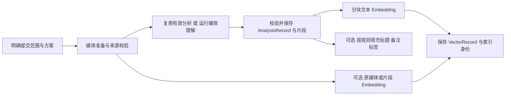

# Lap AI 模型与媒体理解开发蓝图

设计版本：2026-10-23，参考 Cherry Studio 改为服务与默认模型组织，并保留现有独立设置窗口。2026-10-24 已实现 Chat Completions＋文本 Embeddings 首版链路；当前操作和边界以 [使用说明](../../docs/media-understanding.md) 为准，[BASELINE.md](BASELINE.md) 记录改造前基线。所有设计图中的模型、能力、设备和任务数量为示例。协议与部署证据见 [标准 API 调查](../../docs/development/ai-service-protocols.md)。

## 1. 先固定界面骨架

设置继续通过 `Home.clickSettings()` 打开 `/settings`，复用 `settings` 窗口。初始／最小尺寸为 600×620，允许用户拉宽；主设计按附图 1437×833 展示。沿用当前主题、缩放、标题栏、9 个分类、160px 左栏和右侧滚动区。新功能使用现有组件与主题变量，不另设一套视觉样式。

AI 页默认仍显示原图文语义检索和当前 CLIP 配置。原四个任务按钮不变，**只追加媒体理解一个标签页**。上方参考本轮 Cherry Studio 附图：左侧服务搜索、列表与添加入口；右侧显示所选服务名称／重命名、启用、API 密钥与检测、API 地址、同步／添加模型。模型按可编辑分组显示，行尾提供能力图标与模型设置。所有服务使用相同数据结构与表单，没有自建、团队或托管平台类别。名称由用户自定义。

下方保留媒体理解、语言生成、Embedding 三个默认模型选择。首版在最小窗口使用紧凑服务列表和独立滚动的服务详情，原九项设置左栏仍在。模型分组只用于展示，不决定能力或默认用途。没有新增语言生成、Embedding、协议或本机运行标签页。

页签顶部提供“配置 Embedding”快捷入口，默认项右侧也显示“配置”。表单选择已有服务或新建服务，填写 API 地址、按服务要求填写 Key、填写 Model ID；文本 Embedding 能力自动选中，维度由检测读取。常用查询编码预设直接展示，自定义指令和显示名称收在高级设置中。一次“保存并设为默认 Embedding”再次检测并完成服务／模型保存与用途绑定，不要求用户再回下拉框重复选择。共享连接仍归属于服务；模型不复制密钥。字段改变使本次检测失效，取消草稿不改已启用配置；表单内容滚动时，检测和保存操作仍可见。

更换向量模型或编码方案时，界面须提示当前新方案需要建立匹配索引，不能直接用新向量查询旧空间；既有分析和旧空间数据保留。保存配置不会自动提交媒体分析任务。对应设计图为 21、24、25。

当前交付范围只接 API 服务，部署位置、托管平台、模型品牌不参与业务路由。Mage／Qwen 本机下载、Python／原生运行环境与资源管理延后；原有 CLIP、人脸、OCR、对象识别的本机功能保持现有契约。

| 用户位置 | 新入口 | 应复用的现有结构 |
| --- | --- | --- |
| 主窗口齿轮 | AI 模型 → 新用途与配置 | `Home.vue`、`Settings.vue`、`AiModelSettings.vue` |
| 图片／视频查看器 | 理解按钮；文件信息中的媒体理解区块 | `MediaViewer.vue`、`ImageViewer.vue`、`FileInfo.vue` |
| 选中一批媒体 | 整理分组中的媒体理解 | `SelectionPanel.vue`；上下文菜单可调用同一入口 |
| 当前图库／当前筛选结果 | 媒体理解面板中的处理范围与任务 | 遵循 `Home.vue` 的 OCR／对象左侧组件模式 |
| 批量任务配置 | 居中应用内对话框 | `ModalDialog.vue`，不是另一个设置窗口 |
| 搜索 | 现有文本／组合搜索旁增加自然语言模式 | `ImageSearch.vue`，结果继续使用主内容区 |

`FileInfo` 的常规字段、OCR、对象、地图等区块继续存在。独立查看器右侧仍为 23rem、最大 48vw；理解和问答在同一面板中切换。窄窗口先折叠无关区块，避免要求加宽设置或查看器。

## 2. 用户场景与闭环

| 场景 | 完整流程 | 图 |
| --- | --- | --- |
| 连接已部署模型 | AI 模型 → 媒体理解 → 添加服务 → 地址／密钥 → 同步或手填模型 ID → 标记与检测能力 → 页下方选择三个默认模型 | 01、17、08、16 |
| 查看一张图片并整理 | 展示有效分析；无分析时提供理解入口 → 保存结构化分析 → 显示标题、说明、标签建议 → 用户采用 → 正式资料更新 | 02 |
| 批量填充资料 | 多选面板 → 范围快照与预检 → 选择向量／填充字段 → 提交 → 逐项分析和复用 → 分阶段保存 → 查看失败与重试 | 15、04、06、12 |
| 自然语言找媒体 | 输入问题 → 可选条件解析 → 当前可见范围过滤 → 兼容查询编码 → 索引召回／融合 → 打开媒体或视频片段 | 11 |
| 对当前图片提问 | 固定当前媒体 → 读取有效分析和已有标注 → 有证据则回答 → 不足时复核当前图片 → 回答附引用 → 可选采用为说明 | 10 |
| 对视频提问 | 固定视频和时间范围 → 取片段证据 → 回答并跳转原片时间 → 需要时只复核候选片段 | 03 |

查看媒体、进入页面、执行搜索和提问都不会隐式启动全库分析。批量处理必须由明确的任务提交触发。生成标题、说明与标签建议可以来自同一次结构化理解输出，无需为了每个字段重新读取媒体。

## 3. 服务、模型、默认用途

当前模型定义按一个 `task` 分类，每个模型一份参数、每任务一个全局选择。此次方案需要扩展多能力与多部署；这不是现有系统已经实现的功能。

| 概念 | 最少负责的内容 | 不应混入 |
| --- | --- | --- |
| 模型服务 | 稳定 ID、名称、API 基础地址、凭据引用、启用状态、传输许可；首版固定 OpenAI 兼容 | 按媒体理解／生成／向量各复制连接、部署平台字段 |
| 已配置模型 | 稳定 ID、所属服务与远程模型 ID；显示名与分组；能力、版本、限制、参数覆盖与回执 | 重复保存上级服务的地址和密钥、把显示分组作为能力判据 |
| 默认用途绑定 | 媒体理解／语言生成／Embedding → 已配置模型＋处理方案 | 某模型品牌的条件分支、正在执行任务的可变引用 |

同一服务可有多个模型，一个模型可承担多个用途；同一检查点也可分别配置在不同服务器或本机。底层资源目录继续维护检查点、适配器与包定义，但用户先配置服务再选模型，不按互斥的 Mage／VLM／LLM 类别复制配置。

### 能力与默认用途

| 能力契约 | 主要用途 | 关键验证 |
| --- | --- | --- |
| 文本生成 | 查询条件解析、说明润色、基于证据回答 | 文本输入、输出长度；需要结构化结果时验证相应约束 |
| 图片理解 | 图片分析、视觉细节复核 | 实际图片输入；方向、尺寸、裁剪与多图数量 |
| 视频理解 | 片段分析、时序问答 | 原生视频与帧序列分开声明；时间映射、最大覆盖范围 |
| 结构化输出 | 分析记录、查询计划 | schema 校验与错误恢复；不能只看 API 是否返回 JSON |
| 文本 Embedding | 分析描述索引、查询编码 | 文档／查询编码角色、模型版本、向量空间与归一化 |
| 图片／视频 Embedding | 原媒体或片段检索 | 与文字查询对齐的编码契约；视频能力单独验证 |
| 专用识别 | 人脸、OCR、对象 | 保留各自已有输出契约、人工修订与业务入口 |

模型声明、适配器实现和具体部署的测试结果必须分别记录。可选用途取三者交集，再检查设备与数据传输策略。一个测试通过不代表所有能力通过；仅列出模型 ID 的 API 不能证明支持图片或视频。

界面只有媒体理解、语言生成、Embedding 三个默认项。媒体理解同时作为图片和视频默认来源；批量预检按实际媒体类型检查能力，缺少视频能力时提示更换模型或处理范围，不自动回退其他服务。语言生成可以复用同一个模型。Embedding 首版用于分析描述与查询文本，选择支持文本编码的向量模型；未验收的多模态输入扩展不可选。任务内部仍保存具体用途、模型与处理方案快照。

CLIP／SigLIP 类图文对齐编码器适合匹配的图文检索；专用或多模态 Embedding 适合其契约允许的文档、图片、视频索引；生成式 VLM 用于分析与回答。不要把生成模型的隐藏特征默认当成可跨模型检索的向量，也不要把任意长描述直接塞给现有 CLIP 短文本编码器。

Mage-VL 一类完整生成模型通过媒体理解适配器接入。单独的视觉编码器需要匹配的视觉投影、语言侧与处理协议；不能承诺把 Mage-ViT 接到任意文字模型上就能工作。具体后端证据见 [调查](../../docs/development/generative-backends.md)，实施时仍按确切模型包验收。

## 4. API 接入与后续本机扩展

### 本机（后续范围）

来源在抽象上分为 API 与本机，业务按能力调用。以下保留为后续扩展约束，不在首版图中出现 Mage／Qwen 的环境、下载或引擎选项。实施时复用现有 `ai/assets.rs` 的下载进度、校验、取消和原子安装体验，分别管理运行环境资源与模型资源。

- 已适配的普通 ONNX 任务继续使用当前执行机制。生成式 ONNX 后端的处理器、分词器、视觉侧与解码循环应由对应适配器负责；`.onnx` 后缀不足以判断可运行。
- 原生推理后端、受管 Python 后端按资源包单独定义。不要把开发期转换脚本等同于用户端必须安装 Python，也不要随意执行下载清单中的任意命令。
- 受管环境使用应用管理的隔离目录与锁定依赖。环境、权重和设备分别报告状态；缺少运行环境不等于模型全局“不支持”。
- 模型包按检查点、格式、量化、视觉投影／处理配置、引擎版本、平台架构和资源哈希确定身份。只提供真正适配过的组合，不展示随意互换的后端选项。
- 沿用硬件诊断与实际推理测试的区别；加载失败、显存不足、资源损坏应显示具体恢复入口。下载完成不自动启用。

### API

复用当前凭据存储、代理与许可机制的公共部分；现有 Jina embedding 请求协议不能作为通用对话协议直接使用。新增生成、Embedding 或专用媒体 API 适配器分别处理编码和响应校验。

服务字段包括名称、基础地址、凭据引用、启用、超时和传输许可。服务内模型保存模型 ID、能力、版本、输入限制、参数和验证回执。API 可以部署在任意服务器、工作站或网关，不用托管平台名称分类；用户自行启动的本机 API 也沿用 API 连接方式，区别于 Lap 管理的本机引擎。

首版仅支持 OpenAI Chat Completions 与文本 Embeddings，不提供协议选择，不实现 Responses／Messages 分支。成熟 Rust SDK 处理请求和流，Lap 业务层管理配置、授权、媒体准备、结果校验和任务。既有 `genai` 调查仍可参考，但只启用 OpenAI 适配器；不得靠模型名称猜协议。视频使用采样帧＋时间说明；标准文本 /embeddings 不自动覆盖图片／视频向量，多模态能力需后续独立验收。详见 [协议调查](../../docs/development/ai-service-protocols.md) 与 [SDK 可行性](../../docs/development/ai-client-libraries.md)。

Vue 负责设置和交互，Rust 通过 Tauri command 接收业务请求，逐段内容通过 IPC Channel 回传，后台任务继续由 Rust 持有。SDK 自定义 HTTP 客户端必须应用项目的代理、TLS 和超时策略；现有 reqwest 0.12 与 SDK 0.13 的类型边界单独处理。图中的设计解释另列于 [NOTES.md](NOTES.md)，不作为产品 UI 导出。

保留现有 HTTPS 规则，回环服务例外；设计中的内网例子使用 HTTPS。远程测试用公开或合成样例，不默认读取真实图库。前台传输与后台批量许可分开；本机严格模式不得向未允许的端点发送媒体、分析文字或查询证据。凭据、原始图片和服务响应正文不进入普通日志。

保存参数不自动测试或启用；保存并测试先保存再执行，测试失败保留配置。回执绑定部署配置、实际模型版本、处理器和凭据修订。端点或版本改变后，使相关回执失效。服务未提供实际版本时记录为未知，不能假装可完全复现。

## 5. 后台理解与索引链路

1. 范围必须从当前图库可见媒体解析为可复现快照，支持选中、当前筛选结果、当前图库。大型图库使用分页／游标，不把全库原文件或帧全部读入内存。
2. 任务固定媒体 ID 与源版本、模型部署修订、分析方案、采样参数、Embedding 契约、填充规则。修改设置或切换图库不会改变进行中的任务。
3. 图片按方向与适配器尺寸处理；视频提取带原片时间的帧或片段。片段覆盖范围、采样间隔、缩放、缺帧和读取失败都应记录。声音、ASR 和精确事件定位必须有单独能力，不能从“能看视频”推导出来。
4. 分析至少输出摘要、标题建议、说明建议、标签候选、证据与覆盖信息。视频同时输出片段与原片时间。结果经类型、长度、范围校验再保存，推理失败不能伪装成“空内容”。
5. 可复用分析由源版本、分析方案、部署／模型修订、处理器修订共同决定。Embedding 失败仍保留分析；更换向量模型可只重新编码有效文字。
6. 说明与片段按确定方案分块，保存块与原分析／片段的映射。文本索引和原媒体向量分别维护；若只做文字描述检索，不强制再跑一次视觉 Embedding。
7. 正式资料写入是独立分支，分析或向量成功不自动授权它。索引可稍后建立，分析结果也可单独使用。

### 能固化与复用什么

| 数据 | 是否持久化 | 复用限制 |
| --- | --- | --- |
| 可读分析、片段摘要、证据引用 | 是，当前图库数据库 | 覆盖有限，不可能包含所有未来问题的答案 |
| 文本／多模态检索向量 | 是，绑定索引身份 | 需要匹配的查询编码；同维度不代表同向量空间 |
| 解码帧、缩略图、裁剪、采样时间映射 | 可缓存到派生资源目录 | 有容量与清理策略；源或处理器变化后失效 |
| 视觉 token、KV cache、服务端媒体句柄 | 仅在适配器明确支持时缓存 | 可能绑定进程、会话、问题或服务有效期；不是统一可移植数据库特征 |
| 问答历史和证据引用 | 独立会话记录 | 回答仍需针对新问题生成；历史不能冒充新的视觉证据 |

因此，预处理可以减少重复计算，但不能让所有未来问题都变成数据库取值。全库搜索依赖索引；当前单张图片或少量视频片段的细节问题，可以按需再运行视觉推理。

## 6. 自然语言查询

例如“找出 2025 年四星以上有湖边木屋的照片和视频”，日期、评分、类型进入现有筛选条件，内容短语进入检索。`QueryPlan` 只接受应用白名单字段和操作符；不执行模型生成的任意 SQL。用户可在现有组合筛选器中修正解析条件。

纯语义短语可以直接编码，不必先运行文字 LLM。若查询包含复杂字段且没有可用语言模型，应提示改用手工条件或仅检索文字短语，不能声称所有条件已生效。

查询必须使用索引记录所要求的编码器角色、版本、分块／预处理和度量方式。原媒体多模态向量只有具备对齐的文本查询编码时才参与文字找媒体。多个不兼容向量空间分别召回；不要直接比较其余弦分数，可用排名融合。过滤必须进入候选生成或可靠的补取过程，避免只在很小的全库 Top-K 后过滤。

返回 `fileId`、可选 `segmentId`、原片时间及命中依据。显示内容索引覆盖数量；未分析、已分析未建向量、向量失效、检索未命中是不同状态。查询不自动创建分析任务，更不逐张重新理解媒体。

现有 CLIP 图文检索可继续作为独立的检索路径；本方案的新描述索引与可选原媒体索引，不意味着当前专用任务已自动支持多模型历史索引。

## 7. 单媒体问答

1. 会话固定 `libraryId + fileId + sourceRevision`；视频可再限定原片时间范围。默认不访问其他媒体。
2. 图片先读取本图有效分析、标题／备注、OCR、已确认标签和相关标注。长视频在指定范围内检索片段；必要时对问题做查询编码，取少量候选证据，不能把整段视频的所有帧无界装入上下文。
3. 证据足够时，语言生成部署基于证据回答。可使用与媒体理解相同的部署，无需人为拆成两个模型或强制两次请求。
4. 证据不足时明确说明。用户点击“复核当前图片／当前片段”，或已开启的同等范围策略允许时，调用对应媒体理解部署，只处理该范围；仍需遵守该部署传输许可。
5. 返回回答、证据引用、是否读取原媒体、实际处理范围。区分“根据已保存记录”和“本次视觉复核”。模型猜测不能生成虚构时间点或 OCR 原文。
6. 视频证据点击后跳转到原片时间。采样片段命中只提供片段范围，不能当作逐帧准确的事件起止边界。
7. 问答仅保存会话和专属复核证据，不自动改写整图分析、标题、备注或标签。用户“采用为说明”才触发正式资料写入；“重新分析”另建明确任务。

复核后仍无法确认的内容，应回答无法确定。问题所需能力不支持、原件离线、证据过期、服务不可用分别返回可操作状态。分析文字、OCR 和用户问题作为数据输入处理，不能授权模型改数据库、联网或扩大媒体范围。

## 8. 持久数据与失效

以下为逻辑记录，不要求为了这些名字新增一套通用框架。落表与索引实现应先检查现有 SQLite／向量设施，再做最小扩展。

| 记录 | 最小字段与责任 |
| --- | --- |
| 分析记录 | 分析 ID、图库／媒体 ID、源版本、部署与模型修订、分析与处理器方案、状态、结构化内容、创建时间 |
| 视频片段 | 片段 ID、父分析、原片起止时间、实际采样覆盖、摘要与证据引用 |
| 向量记录 | 向量 ID、分析文本块或原媒体引用、Embedding profile／空间／版本／维度／度量、向量与有效状态 |
| 问答会话／消息 | 当前媒体与时间范围、问题与回答、实际部署、证据快照引用、视觉复核情况、取消／错误状态 |
| 任务与阶段结果 | 固定范围和方案、每媒体分析／向量／填充各阶段状态、取消与重试位置、汇总计数 |
| 正式资料与采用来源 | 使用现有标题、`comments` 备注和标签关系；记录 AI 采用来源与人工修订，不复制另一套正式说明字段 |
| 标签建议／拒绝 | 候选、词表匹配、分析与源版本、采用／拒绝记录；人工删除或拒绝不被相同 AI 建议反复加回 |

源媒体变化后，旧分析、片段、向量不能用于当前内容命中或新问题；历史引用可显示过期状态。文字人工编辑只使依赖该文字的向量块失效，不应重新跑整库视觉分析。设备或线程改变是否影响结果，由现有 profile 与适配器契约确定，不能一律删库。

新内容索引按身份构建并在有效后激活；失败时保留此前可用记录。专用识别的旧失效机制保持原语义。本地帧和模型内部缓存实行容量限制；清理派生缓存不删除原文件或正式资料。会话清除和派生数据清理分别处理引用，不能让旧引用指向新媒体。

### 正式字段写入

单项采用和批量填充共用写入服务。默认标题／备注只填空白；写入前在事务内比较当前字段修订、源版本与提交时快照。处理中有人修改则跳过并计数，绝不把旧 AI 建议覆盖回去。

标签默认匹配当前词表并追加，不替换人工标签。未匹配词先保留为建议；只有明确开启允许创建标签时才落新标签。拒绝记录跟随来源与媒体版本，不把模型置信度冒充人工确认。标题应使用现有字段验证规则，不把生成标题当作重命名文件。

## 9. 任务、状态与恢复

整体状态至少区分待预检、排队、运行、正在停止、已停止、完成、部分失败、失败、已取消。每个媒体的准备、分析、向量、正式写入单独记录；界面显示分阶段数量和完成全部步骤的媒体数，不能把一次推理调用数当作媒体完成数。

停止后不再派发新工作；正在执行且不可中断的推理到安全边界结束。恢复只处理未完成阶段。向量失败可只重试向量，保留有效分析与已完成资料；不支持的输入、权限不足、原件离线也不能记为无内容成功。

应用退出或崩溃后把运行中任务标记中断，重开时显示恢复入口。后台任务属于原图库，不依赖当前页面；调度时明确获取其图库上下文，事件包含图库、任务、媒体与修订标识，避免写入当前打开的另一图库。

复用 `t_media_jobs.rs` 的取消／上下文能力和现有下载／任务横幅交互；补充理解任务所需的持久阶段记录。不要为了实现这些固定业务，引入一个能任意调用工具和修改资料的通用 Agent。

## 10. 开发顺序与验收

| 阶段 | 交付 | 核心验收 |
| --- | --- | --- |
| A 模型能力与部署 | 扩展定义、配置、回执与用途绑定；原设置窗口内表单 | 旧四类任务可用；一模型多部署；同部署复用用途；保存／测试／启用语义不混淆；未保存草稿保护 |
| B 单媒体理解 | 一条 API 适配器、结构化分析持久化、FileInfo 区块 | 真实图片／视频样例；覆盖与版本正确；重复分析复用；建议不自动写正式资料 |
| C 批量与资料 | 范围快照、分阶段任务、标题／备注／标签采用 | 选中范围不扩大全库；保护并发人工修改；取消／重启／部分失败恢复；向量可单独重试 |
| D 内容检索 | 文本 Embedding、查询计划与搜索入口 | 实际索引检索；跨向量空间隔离；条件生效；未建索引覆盖提示；搜索不触发重分析 |
| E 当前媒体问答 | 证据读取、回答与引用、受限视觉复核 | 当前媒体范围；原片时间跳转；证据不足分支；问答不隐式写入资料 |
| F 后续扩展 | 本机生成引擎、资源包；多模态向量输入适配 | 不在首版范围；分别验收本机运行、资源下载和多模态向量接口，不由能力标记自动启用 |

首版完成 A–E 的 API 链路，F 延后，不要求并行建设 Python 环境或本机生成后端。先完成一条真实端到端链路，再扩展输入和模型包；当前设计图不保证示例模型已经验证所有能力。

设置验收至少覆盖 100% 的 600×620 以及现有缩放比例、内容滚动、操作栏可见、长模型名、未安装／离线／测试失败、未保存切换和关闭。业务验收另需真实 Tauri、样例媒体、数据库和模型调用，本次独立原型只验证布局与模拟交互。

## 11. 从部署脚本到功能的契约

实际部署入口为 [服务器工具](../../scripts/ai-server/README.md)，固定数据源为 [profiles.json](../../scripts/ai-server/profiles.json)。原型从相同文件读取默认端口、model ID、模型 revision、1024 维与查询指令，避免设计图和脚本出现两套值。服务名称仍可自由编辑，部署平台不参与业务分类。

### 最少部署组合

| 服务 | 具体配置 | 负责 |
| --- | --- | --- |
| 生成模型，二选一 | Mage `:8000/v1` / `mage-vl`；或 Qwen `:8001/v1` / `qwen3-vl-4b-instruct` | 媒体理解、结构化资料建议、文本生成、受控条件解析、证据问答 |
| 文本 Embedding | `:8002/v1` / `qwen3-embedding-0.6b` | 分析描述入库编码、自然语言查询编码与匹配检索 |

只部署生成模型时，理解、建议和单媒体问答仍可用；向量生成明确禁用，已有分析可保留。补配 Embedding 后只需对有效分析重新编码。界面“语言生成”默认选择“与媒体理解相同”，更换媒体模型会同步跟随；用户仍可显式另选。两个服务可以部署在不同机器，同一卡并行容量必须实测。

### 首版结构化输出与向量编码

- 分析请求使用标准 Chat Completions 的文字／图片块；视频由应用分片、采样并携带原片时间，不让模型猜测精确时间。每次返回 `title`、`description`、`tags`，客户端校验 JSON、字段类型和长度；不以“支持 JSON”标签代替实际输出验收。
- 描述入库文本为 `title + 换行 + description + 换行 + 标签： + tags.join('、')`，编码方案标记为 `media-analysis-v1/plain-text`。长视频按已记录片段分别保存文字与源时间。
- 文本向量发送 `/v1/embeddings`，`input` 为正文数组，`encoding_format` 为 `float`；检查数量、每项 index、1024 维、有限值和非零范数。正文不额外添加查询指令。
- Qwen3 查询编码为 `Instruct: {profile.queryInstruction}\nQuery:{query}`，使用同一模型、维度和向量空间。其他模型按其预设配置，不能一律套用 Qwen 指令。
- 向量按 L2 归一化，以余弦相似度检索。索引身份绑定模型／声明的 revision、维度、正文方案、查询指令、归一化和度量，不由服务显示名称或密钥决定。服务端没有报告版本时，记录为声明值或未知，模型列表不能证明实际权重版本。
- 用户更换默认模型不改进行中任务。查询按已保存索引的编码与连接快照选择可用部署，不能把新默认模型生成的查询向量直接与旧空间比较；所需旧部署失效时明确要求重建或恢复，不自动混用向量。

### 验证层次

“检测服务”只验证连接／认证或可用模型信息；无列表接口时仍可手填模型 ID，Embedding 服务不需要聊天接口。模型检测按能力选择生成或向量请求；向量设置单独检测正文和查询，并记录维度与方案。

新增 [22](22-workflow-verification.png) 展示图文输入 → 结构化分析 → 正文向量 → 查询向量 → 持久化召回 → 引用回答。对应的 `pipeline_probe.py` 可请求真实端点，使用独立临时 SQLite 做保存、关闭、重开和按空间检索；不是对正式 Lap 图库／索引的验收。

| 验证层 | 已有证据 | 仍需验收 |
| --- | --- | --- |
| 部署计划与 API 编解码 | 固定 profile、标准请求、认证、回环 HTTP、错误脱敏 | 真实 GPU 安装、驱动／显存和推理 |
| 媒体准备与模型契约链路 | 实际 FFmpeg 测试视频采样、JSON、正文／查询向量、SQLite 重开、证据引用测试 | 中文模型效果、真实视频覆盖和检索相关性 |
| 设计原型 | 缺向量服务的降级、补配与绑定、索引任务、查询、任务快照和两种窗口布局 | 正式 Tauri、Rust 调度、真实图库索引及资料写入 |

标题、说明和标签写入仍由 Lap 的显式采用／填充事务负责；模型脚本不会改原媒体或替代正式资料写入服务。直接对原图片／视频做多模态向量不属于上述两服务组合，后续另适配，不作为本轮链路“通过”的隐含能力。
