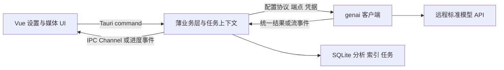

# Vue／Tauri／Rust 的 AI 客户端可行性

核对日期：2026-10-23。结论：保持现有 Vue 前端和 Rust 后端，优先用成熟 Rust SDK 处理模型协议；不需要为远程 Mage／Qwen 在本机增加 Node 或 Python 服务。当前推荐先采用 **`genai = 0.7.0`** 的薄集成，完成真实端点验收后再进入产品实现。

本轮已在独立工具中编译真实 SDK 并运行回环 HTTP 测试。没有把 SDK 加入 Lap 正式依赖，也没有进行真实 GPU／云端模型调用。

## 1. 当前代码中可以复用的部分

| 当前设施 | 依据 | 接入方式 |
| --- | --- | --- |
| Vue 3、Pinia、Tauri 2 JS API | `src-vite/package.json` | 继续实现服务、模型、默认用途表单与问答 UI |
| Tauri 2、Tokio、Serde | `src-tauri/Cargo.toml` | Rust command、异步模型调用、结构化业务结果 |
| reqwest 0.12.28 | 同上 | 保留现有网络调用；共享代理／TLS／超时策略的配置逻辑 |
| 系统凭据存储 | `ai/remote.rs`、`ai/settings.rs` | 服务引用凭据，Rust 加载真实密钥；密钥不经过推理结果回传 Vue |
| 现有网络与代理管理 | `t_network.rs` | 为 SDK 的 HTTP 客户端应用同等策略，保留回环与远程规则 |
| SQLite 与媒体任务 | `ai/profiles.rs`、`t_media_jobs.rs` 等 | 保存分析、索引身份、任务快照和进度，继续保护人工资料 |
| 本机 ONNX 与 Jina | `ai/adapters/`、`ai/remote.rs` | 保留专用契约，多模态向量不硬套标准文本 Embedding |

这些设施不需要被新的 AI 框架整体替换。

## 2. 候选库

版本取自核对时 crates.io 的稳定版本和对应发布包源码，不以 README 的模型品牌列表作为验收。

| 库 | 已确认的覆盖 | 与 Lap 的适配 | 建议 |
| --- | --- | --- | --- |
| `genai 0.7.0` | OpenAI Chat、Responses、Anthropic；图文、流式、文本 Embedding、自定义端点／认证／reqwest 客户端、JSON Schema 请求 | 统一客户端与当前需要接近；能够按配置绑定 adapter，不要求内置 Mage 名称 | 首选候选，固定版本后接入 |
| `rig-core 0.45.0` | 多 provider、Completion、Embedding 与流；Rig 生态另提供 Agent／RAG 模块 | 可直接使用 core，无需一定使用 Agent；当前版本拆分 HTTP transport，并声明 Rust 1.97.1 | 将来需要更完整 Agent／RAG 编排时继续评估 |
| `async-openai 0.42.2` | OpenAI Chat、Responses、Embedding、SSE、细粒度 API 类型与功能开关 | OpenAI 专属接口覆盖细；不提供 Messages 到统一生成请求的完整转换 | 需要 OpenAI 特有 API 时评估，不作为当前唯一多协议门面 |

`genai` 是社区维护的库，MIT／Apache-2.0 双许可；后两者为 MIT。当前本机 Rust 1.99.1 能构建验证工具。`genai` 的包没有声明精确 MSRV，使用 edition 2024；最低工具链应按锁文件与项目 CI 验证，不从 edition 推断整条依赖链的最低版本。

`genai` 的 `AdapterKind::OpenAI`、`OpenAIResp`、`Anthropic` 分别处理三种生成协议，`Client::embed` 处理标准文本向量。图片通过统一 `ContentPart` 转换。以 `with_adapter_kind` 绑定服务所配置的协议，再设置端点与认证；不要让 `mage-vl` 或自定义服务模型 ID触发按名字猜路由。

## 3. 推荐的运行边界

前端负责配置编辑、当前媒体／片段范围、提问输入、进度展示和显式采用。Rust 负责凭据、传输许可、网络、媒体预处理、任务与数据库。多个界面调用同一个业务门面，不分别创建 provider 客户端。

建议仅在现有 `ai` 模块中补一层生成业务接口，隐藏 SDK 类型：请求使用 Lap 的媒体引用／文本／输出约束，结果使用 Lap 的文本／结构化内容／用量／来源。SDK 负责三套请求体和事件解析；Lap 负责服务配置、模型能力回执、任务快照与业务规则。

SDK 已能在自定义端点查询 `/v1/models`。同步仍要保留手填 ID、列表失败与实际能力验证的区别；不能用某个 SDK 的静态模型目录覆盖服务实际返回的数据。

### 前后端流式通信

Tauri 官方提供 `tauri::ipc::Channel<T>`，前端由 `@tauri-apps/api/core` 的 `Channel` 接收 Rust 消息，适合传递逐段文本。第一版不需要在本机另开 HTTP 服务来给前端制造 SSE。

Rust 将 SDK 的事件转换为项目自己的 `requestId/libraryId/fileId` 加类型化事件，例如开始、可见文本增量、用量、完成、失败。原始 SSE、密钥、base64 媒体和未经处理的错误正文不作为普通 UI 事件发送。推理内容和可见回答也应区分。

单媒体问答随会话操作取消；批量任务由 Rust 持有，切换页面不销毁任务。Channel 是当前窗口的订阅，持久任务状态继续存库，重新打开界面时可查询。已有任务横幅与事件机制可以继续承接批量进度。

## 4. 具体接入点与限制

### reqwest 版本边界

Lap 当前直接依赖 reqwest **0.12**，本次检查的 `genai 0.7.0` 与 `async-openai 0.42.2` 使用 **0.13**。不同版本的 `Client` 是不同 Rust 类型，不能把现有客户端直接传给 `with_reqwest`。

第一版可让 SDK 使用独立的 0.13 客户端，例如通过 `reqwest_ai` 依赖别名构建，读取 Lap 同一份代理、超时、证书和回环策略。保留现有下载、地图等 0.12 调用。后续如统一版本，再单独验证整个网络层，不把全局升级夹在 AI 功能中。

验证工具采用 `genai` 关闭默认 TLS 功能、自定义 reqwest 0.13 和 Rustls ring provider。正式接入时还要核对应用现有 Rustls provider 的初始化与跨平台构建；不能在未验证时混开多套 TLS 默认功能。

### 模型能力与结构化输出

SDK 能序列化图片、请求 schema，不代表每个服务或模型都支持。仍要按服务／模型／配置修订保存验证结果。通用视频继续使用采样帧与原片时间说明；Mage codec、原生视频和多模态向量扩展继续各自验收。

返回的标题、说明、标签和查询计划用现有 Serde 类型解析，并校验长度、范围、允许字段与枚举。JSON Schema 请求只是一种约束手段；无效结果不能写成空白成功。自然语言查询使用受控条件计划，不执行模型自由生成的 SQL。

标准文本 Embedding 可使用 SDK；当前 Jina／ONNX 多模态契约继续保留。SDK 不替代向量空间身份、分块方案、相似度召回、人工字段冲突保护和缓存失效。

### 取消和重试

可以用 `tokio_util::sync::CancellationToken` 配合 `tokio::select!` 停止请求等待或流消费。回环检查已验证 chunked SSE 的首段文本无需等待终止帧，本地取消后测试连接关闭。

服务器是否立即停止 GPU 推理、是否继续计费，必须按其 API 单独确认。后台“停止”仍按既有约定停止新派发、保留已完成结果，并在安全边界结束；不能把客户端取消直接显示为所有远端计算已终止。

重试应由业务明确控制请求类型、已完成阶段和预算，核对 SDK 的默认行为。不要让下载或索引的“可安全重试”规则自动套到可能重复生成的请求。

### 异步任务与图库上下文

现有部分任务控制与图库上下文使用线程局部状态。Tokio 的异步任务可能在不同工作线程继续执行，不能把这些同步作用域直接跨 `.await` 使用。

生成任务显式携带图库／媒体／源版本、数据库定位和配置快照。网络阶段只使用这些不可变数据；解码与数据库阶段进入有明确上下文的阻塞工作单元，并在写入前重新校验来源与字段修订。提供方和上传许可的撤销也应在派发前复核。

## 5. 前端 AI SDK 是否可用

AI SDK 的 Vue／UI 能力和自定义 Transport 都可作为选项。其默认聊天 transport 通常对接 HTTP 流；Tauri `invoke`／Channel 不会自动成为该接口，需要实现自定义 transport 或增加兼容 HTTP 端点。

如果让浏览器端 SDK 管理协议请求，还要处理后台任务脱离 WebView 生命周期、凭据边界与 Rust 作业恢复。使用 Node sidecar 可让 JS SDK 独立运行，但又增加进程、运行时与分发管理。

当前 Rust SDK 已能覆盖所需基础协议，优先走 Rust 调用、Tauri IPC 回传。前端可以继续复用 Vue 组件和状态管理；只有确认某项 UI hook 能节省工作时，再评估其自定义 transport，不要求引入一整套新的聊天服务。

## 6. 已完成的验证与待验收项目

独立工具见 [scripts/ai-sdk-check](../../scripts/ai-sdk-check/README.md)，8 个检查覆盖：

1. Chat Completions 的自定义模型 ID、图片与认证。
2. Responses 图片映射、独立路由与 `store=false`。
3. Anthropic Messages 图片映射与认证。
4. 标准文本 Embedding 请求及向量结果。
5. JSON Schema 请求映射；未把夹具文本当作模型 schema 合规性证明。
6. 自定义 HTTP 客户端保留代理路由。
7. 从自定义服务查询生成与向量模型 ID。
8. chunked SSE 的提前文本、本地取消与测试连接释放。

真实 SGLang／vLLM、Responses／Messages 流式细节、TLS／SOCKS 链路、供应商限流、长媒体、多模态向量及 Tauri 跨平台集成仍需验收。这些不会由“SDK 已支持”自动成立。本轮不改生产依赖、实际模型配置或图库。

## 依据

- [genai 0.7.0 发布包与依赖](https://crates.io/crates/genai/0.7.0)
- [Rust GenAI 官方项目](https://github.com/jeremychone/rust-genai)
- [Rig 官方项目](https://github.com/0xPlaygrounds/rig)
- [rig-core 0.45.0](https://crates.io/crates/rig-core/0.45.0)
- [async-openai 官方项目](https://github.com/64bit/async-openai)
- [async-openai 0.42.2](https://crates.io/crates/async-openai/0.42.2)
- [Tauri：调用 Rust 与 Channels](https://v2.tauri.app/develop/calling-rust/)
- [AI SDK：Transport](https://ai-sdk.dev/docs/ai-sdk-ui/transport)
- [当前协议与服务配置方案](ai-service-protocols.md)
