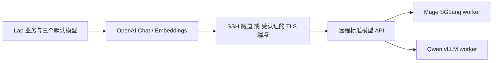

# 模型服务配置与标准 API 调查

核对日期：2026-10-23。本次基于用户给出的 Cherry Studio 设置图、上游源码和官方协议文档。结论用于修订设计及准备远程部署工具；未修改 Lap 正式后端，也未完成 GPU 实机验收。

本轮重新读取了 Mage 官方 `inference_base.py`、Qwen3-VL 官方 README、DeepSeek 调用说明和 OpenAI Embeddings 文档：前两者有 OpenAI SDK Chat Completions 示例，DeepSeek 明确声明兼容 OpenAI，标准 Embeddings 的输入定义为文本或 token 数组。这里核对的是文档／源码契约，真实服务仍需按模型能力验收。

## 结论

Lap 采用 **一个媒体理解标签页 → 多个 OpenAI 兼容服务 → 每个服务的多个模型 → 页下方三个默认模型**。服务持有名称、地址、凭据与启用状态；模型持有 ID、能力、参数与验证回执。媒体理解、语言生成、Embedding 是默认用途，不再分别设置标签页。服务可部署在任意位置，产品配置不绑定托管平台。

Mage 不是只能暴露私有协议：官方在线样例通过 OpenAI SDK 的 `client.chat.completions.create` 调用 SGLang，并用标准 `image_url` 发送图片或视频抽样帧。其专用部分是服务端 Mage 分支和完整媒体处理能力，不应让每个 Lap 业务都写一个 Mage 客户端。

Qwen3-VL 官方也给出了 vLLM／SGLang 的 OpenAI 风格服务部署，DeepSeek 官方提供兼容 OpenAI 的调用方式。首版仅接 Chat Completions 和文本 Embeddings，不实现 Responses／Messages，也不展示协议选择。本机 Mage／Qwen 下载及运行环境延后；既有四类本机识别继续保持现状。

## 1. Cherry Studio 参考了什么

核对源码提交 `aa81ccf95d6a0b7b32c08be53a6af6748700b17c`：

- `src/shared/data/types/provider.ts`：Provider 有名称、启用与连接配置；`endpointConfigs` 按接口类型保存基础地址等连接属性，`defaultChatEndpoint` 指定默认生成接口。
- `src/shared/data/types/model.ts` 与 ProviderSettings 的 ModelDrawer：模型归属服务，管理能力／用途、模型 ID、上下文与接口类型等属性。
- `src/main/ai/provider/endpoint.ts`：解析模型接口覆盖、服务默认接口和实际基础地址，再选择适配器；不仅是替换一个 URL。
- `src/main/ai/provider/listModels.ts`：模型列表按服务协议取得，并有差异处理。
- `src/renderer/pages/settings/ModelSettings/ModelSettings.tsx`：默认模型按业务引用已有模型。

取其共享数据组织与能力标记，不复制管理台导航。Lap 保留原四项任务，只追加媒体理解；新标签页上方管理服务及模型，下方分别选择媒体理解、语言生成、Embedding。连接在服务卡片中展开，不另设服务／默认模型顶层入口。设置仍按用户 1437×833 浅色截图展示，并检查 600×620 最小窗口。

服务可以有多个模型，但“支持列举模型”“模型可推理”“图片或视频能力可用”分别验证。同步失败时允许手填 ID；同步不自动切换默认模型，不删除任务或历史引用所需的模型身份。

### 建议的配置责任

| 对象 | 字段 |
| --- | --- |
| 服务 | ID、名称、启用、基础地址、凭据引用、上传与后台许可、超时；首版固定 OpenAI 兼容 |
| 服务内模型 | 稳定内部 ID、providerId、远程 model ID、显示名、能力、输入限制、模型参数覆盖、按能力回执 |
| 能力标记 | 图片理解、视频理解（首版采样帧）、文本生成、文本 Embedding、多模态 Embedding；另记按能力检测结果 |
| 默认模型 | 媒体理解、语言生成、Embedding → 已配置模型引用；媒体项按类型预检能力 |
| 后续本机来源 | 与 API 分开声明，由 Lap 管理资源和引擎；首版不新增本机生成运行环境 |

现有 Lap `ai-config.json` 每模型一份配置、每任务一个全局选择，当前远程适配仅为 Jina embedding。新增 Provider 与多能力不是改名就能获得，需要迁移旧配置、保留既有四类专用任务的参数／索引语义和草稿保护。

实际 HTTP 协议适配应位于 Rust 后端，复用现有凭据存储与传输策略的公共部分；Vue 只编辑配置、选择模型并展示结果。现有 Jina 请求体仍留在专用适配器，不把密钥交给前端组件直接请求各服务。

成熟客户端的选择与回环验证见 [Rust SDK 可行性](ai-client-libraries.md)。可以继续使用 `genai` 的 OpenAI 适配器及文本 Embedding，Lap 保留薄业务门面；其支持其他协议不等于产品本期需要暴露这些选项。

## 2. 首版 OpenAI 接口与能力边界

| 协议 | 路由 | 图片与文本的主要结构 | 流与结果 |
| --- | --- | --- | --- |
| OpenAI Chat Completions | `POST /v1/chat/completions` | `messages`；内容块 `text`、`image_url` | `choices[].message`／`delta` |
| OpenAI 文本 Embeddings | `POST /v1/embeddings` | `input` 为文本或 token；并非标准的图片／视频上传字段 | `data[].embedding`，检查维度、有限性、范数与索引身份 |

不要使用旧式 `/v1/completions` 代指多模态聊天接口。API 地址只填基础地址，界面预览最终路由；保留网关路径前缀，拒绝内嵌密钥和重复拼接版本段。

内部请求使用角色、文本、图片、带原片时间的帧引用、输出约束和预算，由 OpenAI 适配器编码。响应统一为可见文本、结构化结果、用量、结束原因、错误与引用元数据；文本向量调用 /embeddings。模型列表不提供可靠能力元数据时，允许手工标记再检测，不从模型名推断所有能力。

通用视频路径建议为客户端采样帧＋时间说明，再编码为标准多图输入。它可以覆盖很多图片／片段描述任务，但不等于原生视频 API，更不自动具备语音理解、帧级事件边界或 Mage codec 的完整能力。服务和模型输入上限需要单独记录。

标准 `/v1/embeddings` 不定义通用图像／视频内容块。多模态 embedding 可由现有 Jina 契约或已验证的其他扩展适配器提供；Qwen3-VL-Embedding 等专用向量模型也需按其部署协议核对。不能因“OpenAI-compatible”就把所有生成模型作为 embedding 服务。

## 3. Mage 与 Qwen 的实际服务路径

| 项目 | 确认的事实 | 交付边界 |
| --- | --- | --- |
| Mage 官方在线样例 | SGLang fork `feat/mage-vl`，OpenAI SDK Chat Completions；视频抽样后逐张发送 `image_url` | 优先验收此路径；不为它增加专有的 Lap 业务客户端 |
| Mage fork 的服务路由 | 该固定源码存在 chat、responses、messages、embeddings 等 HTTP 路由 | 路由存在不证明 Mage 在所有路由均支持图文／结构化，更不证明生成模型能输出检索向量 |
| Mage codec／主动流式 | 官方另有离线 codec 和流式推理路径 | 通用抽帧 API 不承诺覆盖这些能力；需要时再增加有明确契约的扩展 |
| Qwen3-VL | 官方推荐 vLLM，并列出 SGLang，提供 OpenAI 风格请求 | 脚本选具体 4B Instruct，固定后端；不把 235B 多卡示例直接用于单卡租机 |

固定来源：

| 来源 | 版本／提交 |
| --- | --- |
| Microsoft Mage 说明／客户端 | `76bec2bb3818863f470de7e867c2dc7f1d0bfd83` |
| Mage SGLang fork | `73beeb4003c8b665b7f769675f31ccc697b207c1` |
| Qwen3-VL 说明 | `96588727e44c78b25ba03ea03b8e12f7e64fd0da` |
| Mage 权重 revision | `d88b153285f1633a61b2f693c59c8576693af185` |
| Qwen3-VL-4B-Instruct 权重 revision | `ebb281ec70b05090aa6165b016eac8ec08e71b17` |

不直接安装未固定的 latest。调查时 Mage fork 的 Python 依赖包含 PyTorch 2.11／transformers 5.8.1，其默认 CUDA wheel 与 Qwen 脚本选用的 vLLM 0.11.0／PyTorch 2.8 不同；脚本以独立 venv 隔离。固定版本仍需真实 GPU、驱动、显存、图片和片段测试，不等于已经形成经过验收的部署镜像。

## 4. 远程部署与 Lap 的关系

图中的 worker 是可选服务目标，不表示单个进程同时托管两个模型。默认脚本给出两个独立端口；确需一个基础地址提供多个模型时，再使用模型路由网关。初次接入无需另外写一层 Mage → OpenAI 转换服务。

默认回环监听＋SSH 端口转发，Lap 使用本机地址但执行位置仍标为远程 GPU。通过平台 HTTP 转发时，按实际 TLS 和认证规则配置；不能把本机路径当成远端可访问的图片路径。

本机仅发送处理后的媒体与文字并消费结果，不下载服务器权重，也不安装服务端 Python／CUDA。离线理解、向量索引、单媒体问答和正式资料写入的边界仍按 [开发蓝图](../../design/media-understanding/SPEC.md) 执行。

部署工具、完整步骤与验证范围见 [scripts/ai-server](../../scripts/ai-server/README.md)。

## 官方来源

- [Cherry Studio Provider 类型](https://github.com/CherryHQ/cherry-studio/blob/aa81ccf95d6a0b7b32c08be53a6af6748700b17c/src/shared/data/types/provider.ts)
- [Cherry Studio endpoint 解析](https://github.com/CherryHQ/cherry-studio/blob/aa81ccf95d6a0b7b32c08be53a6af6748700b17c/src/main/ai/provider/endpoint.ts)
- [Cherry Studio 默认模型设置](https://github.com/CherryHQ/cherry-studio/blob/aa81ccf95d6a0b7b32c08be53a6af6748700b17c/src/renderer/pages/settings/ModelSettings/ModelSettings.tsx)
- [Mage 官方说明](https://github.com/microsoft/Mage/blob/76bec2bb3818863f470de7e867c2dc7f1d0bfd83/mage_vl/README.md)
- [Mage 官方 API 客户端](https://github.com/microsoft/Mage/blob/76bec2bb3818863f470de7e867c2dc7f1d0bfd83/mage_vl/inference_base.py)
- [Mage fork Python 依赖](https://github.com/kcz358/sglang/blob/73beeb4003c8b665b7f769675f31ccc697b207c1/python/pyproject.toml)
- [Mage fork HTTP 服务](https://github.com/kcz358/sglang/blob/73beeb4003c8b665b7f769675f31ccc697b207c1/python/sglang/srt/entrypoints/http_server.py)
- [Qwen3-VL 官方部署](https://github.com/QwenLM/Qwen3-VL/blob/96588727e44c78b25ba03ea03b8e12f7e64fd0da/README.md#deployment)
- [vLLM 0.11.0 包依赖](https://pypi.org/pypi/vllm/0.11.0/json)
- [OpenAI Chat Completions](https://developers.openai.com/api/reference/resources/chat/subresources/completions/methods/create)
- [OpenAI Responses](https://developers.openai.com/api/reference/resources/responses/methods/create)
- [OpenAI Embeddings](https://developers.openai.com/api/reference/resources/embeddings/methods/create)
- [Anthropic Messages](https://platform.claude.com/docs/en/api/messages/create)
- [Anthropic 2026-10-21 版本迁移](https://platform.claude.com/docs/en/api/migration-2026-10-21)
- [DeepSeek 兼容 OpenAI 的调用说明](https://api-docs.deepseek.com/)
- [Qwen3-VL-Embedding 官方仓库](https://github.com/QwenLM/Qwen3-VL-Embedding)
