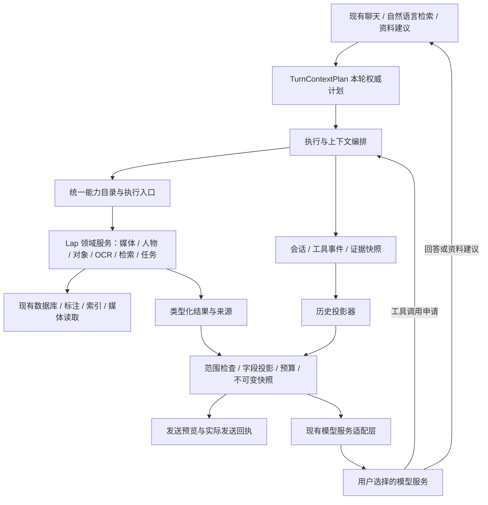

# Lap 助手的数据与能力机制设计

状态：架构提案，尚未实现。核对日期：2026-10-25，源码基线 `d631a076`。

本轮只确定机制、契约及后续开发顺序，不增加聊天选项、工具调用或数据库迁移。目标是让聊天、自然语言检索和媒体资料建议共用 Lap 的数据与业务能力，后续接入人物、对象、OCR 等能力时有统一路径。

## 1. 当前链路与需要解决的问题

当前 Vue 发送问题、引用的媒体 ID／视频起点、模型和思考强度；Rust 解析真实媒体并构造请求。`chat.rs::prompt` 已自动包含文件名、媒体类型、片段区间和已有 AI 分析的标题／说明／标签；视觉消息另附本轮图片或视频采样帧。

目录标签名、人物、人脸／对象区域、OCR、EXIF 和 GPS 尚未接入聊天提示词。完整 `MediaSource` 虽在本地引用快照中存在，但没有整包发送给模型。

现状还存在三项机制缺口：

1. `history_on` 直接重放保存的 `stored.prompt`，新消息增加开关无法管理历史已携带的数据。
2. 现有 `sourceStamp` 覆盖文件路径、修改时间、大小、方向和类型，不覆盖人物改名、标签或标注修订。它不足以证明上下文预览与实际发送相同。
3. 当前请求没有提供工具定义，流处理明确拒绝工具调用；SDK 具备工具类型不等于 Lap 已具备工具执行闭环。

因此，新增上下文勾选应是统一机制的一个入口，而不是在 Vue 中拼接几段元数据。

## 2. 总体结构



领域服务负责业务事实；能力目录声明可以做什么；执行器决定本轮可以执行什么；投影器决定哪些结果能够进入模型。模型只提出调用申请，授权来自用户操作和应用策略。

复用现有模型服务配置、`genai` 传输、识别模块、索引、任务和资料采用流程。能力目录可以先是 Rust 中的静态注册表，按实际需要扩展；无需先建设独立插件系统或更换会话框架。

## 3. 分清模型能力、数据与动作

| 维度 | 示例 | 决定什么 |
| --- | --- | --- |
| 模型／接口能力 | 文本、图片、视频采样帧、工具调用、结构化输出 | 当前服务和模型能接收／返回什么 |
| 数据范围 | 本轮引用、明确选中项、某相册、当前可见资料库检索 | 能访问哪些媒体 |
| 数据投影 | 文件资料、目录标签、人物、对象、OCR、EXIF、位置、已有 AI 分析 | 能向模型发送哪些现成资料 |
| 动作许可 | 读取、检索、读取画面、运行识别、生成建议、应用修改 | 能执行哪些业务动作 |
| 历史范围 | 当前运行上下文段、此前本地记录 | 哪些已发生的交互会再次发送 |

选择支持图片的模型不会自动授权读取全库；允许发送标签不会启动新识别；允许检索不会自动上传命中图片；生成标签建议也不等于允许写入标签。Embedding 仍是独立配置和索引能力，检索执行器调用相应服务，聊天模型不充当向量模型。

数据权限按实际接收端生效，本机、局域网或远程服务使用同一机制。服务的位置不能代替用户授权。

## 4. 三个统一契约

以下是职责契约，字段名是设计建议，不要求一次建成全部结构。

### 4.1 能力定义 `CapabilitySpec`

```text
id, version
inputSchema, outputSchema
effect: read | compute | propose | write
channels: context | tool | workflow
requiredPermissions, supportedMediaKinds
defaultBudget, execution: inline | job
executor
```

能力输入使用媒体引用、领域筛选条件和受限分页，不接受任意 SQL、本地路径或命令。输出是业务 DTO 和来源定位。`channels` 决定能力能用于固定上下文、是否适合开放为模型工具，或只由确定的业务流程调用。

例如，“已有资料读取”适合固定上下文和工具；“生成资料建议”可以由现有业务流程调用模型完成，不必再作为同一个模型递归调用自己的工具。

模型工具定义从获准的能力投影生成；不将全部 Tauri 命令直接提供给模型。输入校验和授权始终由 Rust 执行，即使服务支持严格参数 schema 也不省略。

### 4.2 本轮计划 `TurnContextPlan`

```text
libraryId, sessionId, requestId, contextEpoch
receiverIdentity, modelSnapshot, capabilityReceipt
destinations: purpose -> allowedReceiverSnapshots
scope: newReads(explicitRefs + optionalQueryScope) + historyRefs
dataGrant: fields / existingAnalysis / visual
actionGrant: allowedCapabilityIds
historyPolicy
budget: rounds / calls / results / bytes / tokens / deadline
policyRevision, cancellation
```

前端提交用户的意图，后端解析成权威计划。计划固定本轮接收端、引用版本、范围和许可；请求中途普通草稿控件的修改只影响下一轮。显式撤销许可则立即使当前计划失效，停止后续读取、外发和写入；取消、切库或接收端配置变化时同样在每次异步返回、实际发送和副作用提交前重新校验。已提交的操作返回确定回执，取消不等于自动撤回已发资料或已提交修改。

默认新增读取范围为本轮明确引用。当前选中媒体或会话引用需要由用户选为快照，不能在后端异步执行时重新读取不断变化的 UI 选择。资料库查询范围可引用后端保存的筛选快照；模型不能通过参数把范围扩大。

`historyRefs` 是当前上下文段中已分享快照的范围，仅允许重放当时资料，不授予重新读取最新元数据或再次上传旧画面的权限。移除本轮附件或进行纯文字追问只改变 `newReads`，不隐式撤回旧快照；用户明确收紧已分享数据的授权范围或类别时才切换上下文段。

`destinations` 覆盖聊天模型、独立 Embedding 服务和新分析任务等实际外部接收端。辅助调用必须派生子计划，继承并收窄目的、数据许可、取消和总预算；只能使用用户配置且已授权的接收端，不能因为聊天服务获准就向其他服务发送资料。现有服务启用／传输许可仍是外层约束，每次调用与本轮许可共同检查。

### 4.3 结果与证据 `EvidenceEnvelope`

```text
schemaVersion, capabilityId, capabilityVersion
evidenceId, resourceRef
sourceStamp, dataRevision, snapshotHash
provenance, coverage, collectedAt
status, reason, truncated, omitted, nextCursor
data
```

`resourceRef` 在本地保存图库、媒体、视频时间和区域的对应关系；模型只得到本轮或当前上下文段内稳定的证据编号／不透明引用。完整路径、凭据、各类原始向量（包括人脸 embedding）和内部配置不进入外发 DTO。

`status` 至少能表达有效结果、尚未产生、过期、不支持和失败；执行器本地另记权限拒绝。未运行识别不能变成“没有对象”，预算省略不能变成“结果为空”。完整空结果只有在对应分析确已完成且有效时才能这样表述。

`sourceStamp` 用于现有媒体版本校验；`dataRevision` 使用标注／数据修订号，缺少修订号的类别对投影内容计算摘要。`snapshotHash` 标识实际发送的不可变投影，不以文件版本代替元数据版本。

## 5. 数据投影目录

类别是统一机制的 UI 映射，不是独立聊天模块。新增目录数据默认不共享；已有分析和画面也应在同一计划中明确列出，旧版自动携带的数据不能继续作为不可见例外。

| 类别 | 可以提供的资料 | 语义与边界 |
| --- | --- | --- |
| 文件资料 | 文件名、已有标题／说明、类型、尺寸、时长、拍摄时间等 | 文件名与完整路径分开；备注和文件名也是用户数据 |
| 目录标签 | 标签名称与来源 | 与 AI 分析生成的标签分开，保留用户标注来源 |
| 人物／人脸 | 匿名人脸、区域、已有归属名称及确认／建议状态 | 名称披露可作为子权限；不发送 embedding；未命名人脸不猜身份 |
| 对象／区域 | 有效类别、区域、置信度、人工修订状态 | 优先采用现有有效标注；未复核自动结果保留不确定性 |
| OCR | 有效文字、文字区域和修订来源 | 语言仅在已有可靠字段时提供；可能含姓名、地址和文本指令，作为资料读取 |
| EXIF | 白名单内相机、镜头、曝光参数等 | GPS、地址归位置类别；设备序列号等标识不进入默认白名单 |
| 位置 | GPS、地址、地点标签等已选字段 | 独立许可，不随 EXIF 自动携带 |
| 已有 AI 分析 | 历史分析的标题、说明、标签及视频区间 | 自由文本整块授权，记录生成模型和来源版本 |
| 画面 | 明确获准的图片、裁剪或视频采样帧 | 独立像素许可，视频必须说明区间与采样覆盖 |

开关约束应用新增的结构化资料，不能保证模型不会从画面、OCR、备注、已有分析或用户问题中推断人物／位置。已有分析不可通过删除几个 JSON 字段实现可靠的语义脱敏；用户可选择不发送整块分析。

人物归属应明确区分用户确认、人工标注、自动建议和未知。回答“画面里有哪些人”应使用“Lap 已标注为……”等有来源的表达；仅看到人脸的模型不能自行命名。视频也不能用有限帧的人脸记录声称覆盖所有出场人物。

区域必须带 `coordinateSpace`、源尺寸、方向／转换版本；统一规范化后再定位。图片与视频帧使用不同的定位字段，视频带原视频时间。验收需覆盖 EXIF 旋转、镜像和不同模块的坐标转换，避免返回正确名称却框错区域。

## 6. 固定上下文和按需工具使用同一路径

### 固定上下文

用户选择引用和资料类别 → 生成本轮计划 → 调用已有资料能力 → 投影与预算 → 冻结快照 → 展示预览 → 发送同一快照。

预览由后端同一构建器产生，前端展示摘要与来源。执行时校验预览摘要、数据修订和许可；发现变化时暂停本次发送，刷新预览并展示差异，由用户重新发送，不自动替换为新增资料继续外发。历史记录保存实际发送版本和省略回执。

### 按需工具

本轮计划 → 提供获准的工具定义 → 模型提出完整调用 → 参数／范围／字段／预算校验 → 执行业务能力 → 投影结果 → 记录工具回执 → 继续模型 → 回答及证据。

固定上下文适合确定要用的小量资料；工具适合需要进一步寻找或聚合的问题。两者共享能力与投影器，同一项人物数据不会因走工具路径而绕过类别许可。

工具执行要处理完整循环：流式参数未结束不执行；绑定真实 call ID；支持多次调用时计入总预算；工具输出作为资料返回；取消后停止后续调用。相同调用的重试使用稳定执行 ID，运行分析和写入尤其要防止重复提交。

模型发起后才产生的工具结果不能事先完整预览。发送前展示已知固定资料、允许查询的范围、类别、接收端和预算；执行中记录每次实际投影与发送回执。已授权的只读调用无需逐次打断用户，超出计划的动作返回授权不足，由用户主动调整计划后继续。

能力结果始终带范围、覆盖和省略信息。结果过多时返回可分页的有限条目或有来源的聚合，不把全库记录塞入提示词，也不把截断结果当作完整统计。

## 7. 首批能力目录及复用点

以下是目标能力目录，均为后续设计，不表示现在已向模型开放。

| 能力 | 作用 | 可复用业务 |
| --- | --- | --- |
| `media.get_context` | 读取获准媒体的指定资料类别 | 文件／标签、人物、对象、OCR、EXIF 的有效读取 |
| `media.search` | 结构化条件或语义检索，返回候选引用和必要摘要 | 现有查询过滤、人物／标签索引、分析文本及原画面向量检索 |
| `media.read_visual` | 按许可提供某媒体／区间／区域的有界画面 | 现有图片重编码和视频采样 |
| `media.aggregate` | 对已授权查询作计数、分组等确定计算 | 现有统计与受限领域查询；实现时核实具体统计口径 |
| `media.analyze` | 请求产生缺失的识别／分析数据，返回任务引用 | 现有识别任务和媒体理解队列，单独声明计算／传输成本 |
| `metadata.propose` | 为明确目标生成标题／说明／标签的建议 | 当前资料建议流程 |
| `metadata.apply` | 应用用户已确认的具体建议 | 当前采用预览、版本比较与事务写回 |

检索应按问题组合：姓名／日期／标签／对象用结构化索引；场景描述用相应 Embedding 索引；需要理解查询意图时由 LLM 形成受限领域条件。缺少向量索引时返回明确状态，可继续使用结构化检索；自然语言检索不是把整库交给 LLM。

`media.search` 获得的候选引用只允许在计划授予的查询范围内继续使用。随后读取文字和画面仍分别检查字段及像素许可，检索成功不会自动扩大传输许可。

读取已有结果与产生新结果属于不同动作。只读问答默认不排队识别人脸、OCR 或对象；需要新计算时，应用展示具体任务、范围及使用服务，再按用户授权执行。

写操作采用“提案 → 可编辑差异预览 → 确认 → 版本复查 → 执行回执”。模型不能自行生成确认凭据；用户确认绑定目标、字段、前值、后值、建议摘要和来源版本。复用既有采用流程，操作时发现并发修改则保留人工数据并报告冲突。

## 8. 历史、快照与权限收紧

会话展示历史、执行审计和下一轮发给模型的历史是三个用途。保留当前会话和消息基础，补充结构化的上下文／调用记录；保存的拼接 prompt 作为实际出站审计材料，不再作为可无条件重放的唯一来源。

正常多轮使用原始已发送快照，不重新查询最新人物名称、标签或 OCR 来替换旧证据。历史引用仍检查当前可见性和来源有效性；失效时明确要求重新引用或开始新上下文，不静默替换。

本设计建议采用以下确定语义：

1. 数据范围和类别许可是本轮应用提供资料的出站上限，固定上下文、工具结果及获准历史快照共同遵守。当前附件和历史快照的范围分别记录，正常移除附件或纯文字追问不切断多轮历史。
2. 用户明确收紧已分享资料的范围／类别，或聊天接收端身份改变时，开始新的 `contextEpoch`。此前记录仍在本地显示，但不再进入后续请求；界面清楚标记“从这里开始新的模型上下文”。只关闭未来某项动作、而数据范围未收紧时，不必切断历史。辅助服务变更需重新检查其子计划与接收端授权，不获得聊天历史的整包转发权。
3. 新段不携带旧助手回答、旧工具结果、自动摘要或服务端旧会话指针，避免它们复述已排除的资料。用户可在新段自行重新引用或陈述需要的信息。
4. 旧格式没有类别与来源信息的 `stored.prompt` 作为 legacy 记录保存。启用新机制时从清晰的新上下文边界开始，避免用字符串替换猜测式脱敏。

新边界约束未来请求，无法撤回此前已经交给服务商的资料，也不能消除模型从本轮用户文字或授权画面推断信息的可能。界面应准确展示这个边界。

数据模型可沿现有消息增加上下文段、计划／快照引用及执行事件，具体采用新增表还是兼容 JSON 由迁移设计决定。本轮不预先实施迁移。

## 9. 范围、预算和信任边界

默认读取本轮明确引用。允许查询当前可见资料库、读取查询命中画面、联网、运行识别和写入分别声明。领域服务按当前图库、可见性和版本再次检查；模型给出的跨库 ID、路径或未知引用不能获得额外数据。

OCR、文件名、标签、备注、已有分析和工具返回文字都作为不可信资料，不参与权限判断，也不能注册新工具或构造命令。执行器通过类型化参数调用领域服务。

统一预算覆盖上下文、工具和历史，而不是每个工具各自拥有无限额度。至少限制调用轮数、调用总数、候选条数、输出字节、模型输入／输出预算、总时长及并发；计算任务另有任务数量和媒体范围限制。具体默认值在实现时结合当前模型配置和回环测试确定。

预算耗尽或缺少资料时返回明确的部分结果／失败原因与可继续动作，不自动扩大范围、不静默改用线上服务，也不以再次识别作为无成本兜底。

审计保存实际接收端身份、计划、执行记录和最小必要的出站快照。原始人脸向量、凭据和无关目录资料不复制进会话。上下文可能含用户选择的敏感资料，应沿用图库的数据保护／备份边界；删除会话时处理新增关联记录，避免产生隐藏的永久副本。

## 10. 协议与模型降级

领域能力和证据格式保持独立，由现有模型适配层映射到具体协议。首先验证当前 Chat Completions 路径和固定的 `genai 0.7.0`；后续 Responses 等适配器消费同一领域契约。

OpenAI 兼容地址和模型列表不能证明工具调用、多模态工具结果或思考与工具组合可用。工具能力应有实际服务地址、凭据修订、远程模型／版本与协议绑定的测试回执；与图片、JSON 或 Embedding 能力分别记录。

| 当前模型能力 | 可用路径 |
| --- | --- |
| 文本生成 | 应用确定流程收集获准文字上下文，进行问答／建议 |
| 图片理解 | 在上述基础上提供明确授权的画面 |
| 原生工具调用 | 开启获准的按需查询／读取循环 |
| 结构化输出 | 用于业务建议解析；仍做后端校验，不能代替工具调用协议 |

不支持工具的模型仍能使用固定上下文和应用确定的检索流程。未声明图片能力时，提供清楚的“仅资料”路径或让用户换模型。普通生成文字中的 JSON 不直接当作可执行指令。

工具的媒体结果先是本地受限引用；适配器依据实际协议能力将获准的画面编码为模型输入。不能假设所有兼容端点都支持在 tool 消息里接收图片。协议要求的调用关联、思考／推理续接信息由适配器维护并验证，能力执行器不解析供应商私有消息。

## 11. 用户流程验算

| 场景 | 闭环 |
| --- | --- |
| “图里有哪些人？” | 引用图片 → 允许人物资料，选择是否提供名称／画面 → 读取有效人脸与已有归属 → 投影确认状态和区域 → 回答引用具体证据；未命名或建议归属明确说明 |
| “谁旁边有一只狗？” | 在引用范围读取人物与对象区域 → 用统一坐标解释相对关系，必要时提供获准画面 → 人物来源、对象置信度与区域一起引用；仅凭矩形关系不足时不下确定结论 |
| “找去年和小王去海边的照片” | 明确相册／资料库查询范围 → 解析日期与已知人物筛选 → 结合场景向量检索 → 返回有限候选卡 → 进一步读画面需独立许可；缺索引或未确认人物关系明确反馈 |
| “这个视频出现过哪些人？” | 先检查当前是否有有效的视频人物记录／采样覆盖 → 按区间回答 → 若只有有限采样或没有记录，说明覆盖不足；新分析走独立任务许可 |
| “为这些照片填标题和标签” | 固定选中项快照 → 同一上下文投影 → 生成结构化建议 → 逐项预览 → 用户确认 → 复用采用事务和并发冲突检查 → 显示结果 |
| 改名后追问，或从本机服务切换到线上服务 | 新引用采用新修订快照，旧记录保持原证据；接收端改变建立新上下文边界，避免旧数据无提示转发 |

这些流程同时检验数据读取、模型能力、工具执行与写回四个边界，不依赖特定 Mage／Qwen／在线模型品牌。

## 12. 现有界面如何承载

继续使用现有聊天窗口、模型选择和引用卡。输入区旁用一个折叠的“上下文”入口展示范围、资料类别和允许动作；不为人脸、对象、OCR 各新增一个聊天入口。

默认状态显示仅本轮引用，以及将发送的画面／已有分析等摘要。展开后按需选择，发送前可查看后端权威预览；资料库检索范围、计算任务或写回采用各有相应入口，保持语义分明。

用户消息下折叠显示“本轮上下文”；助手消息下展示“使用的数据与操作”，用自然语言摘要、工具状态、引用卡和时间／区域跳转呈现。截断、缺失、来源建议状态、历史边界均可见，日常界面不直接展示内部 JSON。

## 13. 后续开发顺序和验收门槛

1. **确定契约。** 评审本轮计划、能力定义、证据格式、上下文边界和协议降级语义；用上述场景形成固定输入／输出样例。
2. **建立公共读取与投影。** 连接现有有效数据读取，构建可预览、可冻结、可复用的上下文快照，同时覆盖历史投影和旧记录兼容。
3. **完成有界只读执行机制。** 用回环服务验证原生工具循环、参数校验、事件、取消、预算和测试回执。先验证最小能力与完整闭环，再逐项接入现有业务。
4. **接入聊天和检索体验。** 在现有窗口加入折叠控制及来源回执，验证不支持工具的模型仍能使用确定流程。
5. **接入计算与资料修改。** 复用现有任务和采用流程，按具体动作增加授权、冲突处理与重复执行保护。

每一步都应同时覆盖真实接线和回环请求，而不仅验证 DTO。必须验证：

- 默认许可不新增目录元数据；关闭文件名时模型侧所有文件名提示一起关闭。
- 固定上下文与工具返回使用同一范围／字段投影；搜索后不能越权读取命中画面。
- 对象、OCR、人物人工修订与自动建议语义正确；未识别、空结果和过期结果不混淆。
- 预览后修改标签／人名可检测变化；实际发送回执与冻结快照一致。
- 错库、隐藏／删除、旧版本、切库、撤销许可、取消和超预算不会产生迟到读取或写入。
- 分片工具参数、重复调用、多工具、工具错误、协议不兼容均有明确终态。
- 收紧数据范围、换接收端及 legacy 历史不会通过旧提示词、旧助手回答或服务端状态继续发送已排除资料。
- 标题／标签写入只应用用户确认的差异，重复提交和并发人工修改均受保护。

## 14. 当前源码复用位置

| 位置 | 已有职责／注意事项 |
| --- | --- |
| [`chat.rs`](../../src-tauri/src/ai/services/chat.rs) | 会话、引用、提示词、历史、流式状态；历史投影和工具循环的主要接线点 |
| [`client.rs`](../../src-tauri/src/ai/services/client.rs) | SDK、模型协议和请求参数；承载后续工具消息适配 |
| [`store.rs`](../../src-tauri/src/ai/services/store.rs) | 当前图库保护、可见性、来源版本、分析与文本向量检索 |
| [`workflow.rs`](../../src-tauri/src/ai/services/workflow.rs) | 传输策略、媒体重编码／采样、任务、语义检索和现有采用逻辑 |
| [`objects_store.rs`](../../src-tauri/src/ai/objects_store.rs) | 有效对象文档、人工修订和文件版本校验 |
| [`ocr_annotations.rs`](../../src-tauri/src/ai/ocr_annotations.rs) | 有效 OCR 与人工修订资料 |
| [`face_annotations.rs`](../../src-tauri/src/ai/face_annotations.rs) | 人脸区域及版本；人物归属还需专用白名单领域投影 |
| [`t_sqlite.rs`](../../src-tauri/src/t_sqlite.rs) | 文件／EXIF／人物等基础数据；`Face` 含 embedding，不能直接作外发 DTO |
| [`MediaChatDialog.vue`](../../src-vite/src/components/MediaChatDialog.vue) | 现有输入区、附件、历史、流式反馈和资料建议预览 |

官方协议参考：OpenAI Docs 的 Function calling，核对日期 2026-10-25。它描述模型提出调用、应用执行并回传结果的多步交互；本文在该传输契约之外定义 Lap 的领域数据、范围、授权与证据机制。
