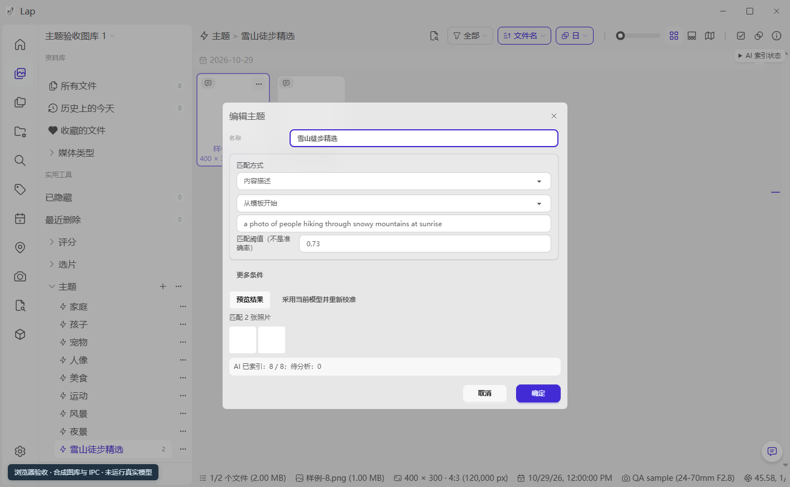

# 可配置主题验证

日期：2026-10-29。

## 交付行为

- 图库主题栏复用智能相册定义，支持新增、编辑、固定／取消固定和上下移动；普通智能相册也可固定到主题栏。
- 新建主题使用简化表单，可选择文字描述或参考照片并调整阈值；保存前必须成功预览。复杂主题默认展开完整规则，保留日期、人物、地点及人工包含／排除。
- 原有八个主题按图库一次性迁移。迁移读取本地后端 AI 配置快照，沿用当前模型的主题阈值与指纹；不启动图库识别或上传原照片。
- 默认主题名称跟随界面语言，用户改名后保留自定义名称。移除或清空主题栏后，重载不会补回；确认恢复默认时仅重置内置主题，自建相册保留。
- 主题的分页、计数、分组、排序、地图查询和索引状态沿用智能相册路径。修改名称、计数、封面和固定状态不触发照片结果重查。

## 同时修复的问题

- AI 语义／参考图规则原先会通过通用数值规范化，把 `0.25`、`0.73` 等阈值取整；现在查询、预览和保存均保留小数。
- Rust 图库配置强类型补齐主题元数据与迁移版本，防止真实 IPC 保存／读取时丢字段。
- 保存返回失败时不再写入成功缓存；首次迁移保存失败保持可重试，读取图库失败时禁止用空默认状态自动保存。
- 初始化失败显示重试入口。已载入图库只重试主题初始化，不重跑图库加载或暂停正在运行的扫描。
- 切换图库后旧保存、预览和菜单操作不能写入新图库；排序菜单的目标已移除时安全退出。

## 验证结果

| 检查 | 结果 |
| --- | --- |
| 最终前端 Node 全量 | 1398 通过，0 失败 |
| 确认框本地化后的主题导航专项 | 13 通过，0 失败 |
| 前端生产构建 | 通过，保留既有大包体积提示 |
| 真实 Rust 图库配置类型及新增往返用例 | 轻量原文提取验证 3 通过 |
| 隔离浏览器 | 35 项断言通过，运行异常为 0 |
| `git diff --check` | 通过 |
| `cargo fmt --check` | 既有格式差异，首处为未修改的 `build.rs:530` |

前端测试覆盖实际组件模板与脚本、真实 Pinia 保存重载、阈值与模型身份、默认迁移幂等、故障重试、跨库旧响应、固定操作、查询刷新依赖及空主题栏保留。

## 浏览器检查

使用独立的本地 Vite 测试服务和无头 Edge，挂载真实应用组件；IPC、媒体和语义结果均为合成数据。检查了新建与预览、预览失败保留草稿及禁用保存、编辑名称／描述／阈值、两个入口共用同一 ID、取消固定与重新固定、主题排序分组写回、浏览器重载、跨图库隔离及取消固定默认主题后的重载。

此检查不读取用户图库，不调用真实模型，不替代原生 Tauri 窗口或检索质量验收。



## Rust 验证边界

已执行 `node scripts/prepare-native-runtime.mjs`。实际尝试以下命令，但正在运行的用户 `cargo tauri dev`／`cargo run --no-default-features` 持有构建锁，均未能进入完整检查，不能计为通过：

```powershell
cargo test --manifest-path src-tauri/Cargo.toml --no-default-features t_config::theme_state_tests -- --test-threads=1
cargo check --manifest-path src-tauri/Cargo.toml --no-default-features
```

替代的轻量验证直接从当前 `t_config.rs` 提取图库状态类型和新增测试原文，使用当前缓存的真实 Serde 依赖编译并执行，覆盖旧配置默认值、主题元数据、规则与人工调整的序列化往返、空主题栏和用户改名。该验证不等于整个 Rust 应用已重新编译。

没有结束用户的开发实例；只清理本轮自己的等待检查与隔离浏览器。新后端配置字段需在开发实例重启并重新编译后生效。全仓库格式检查仍有既有差异，未做无关格式化。

## 复现前端检查

在 `src-vite` 执行：

```powershell
node --experimental-strip-types --test tests/smartThemes.test.ts tests/smartAlbumComponents.test.ts tests/themeNavigation.test.ts
node --experimental-strip-types --test tests/*.test.ts tests/*.test.mjs
pnpm build
```
