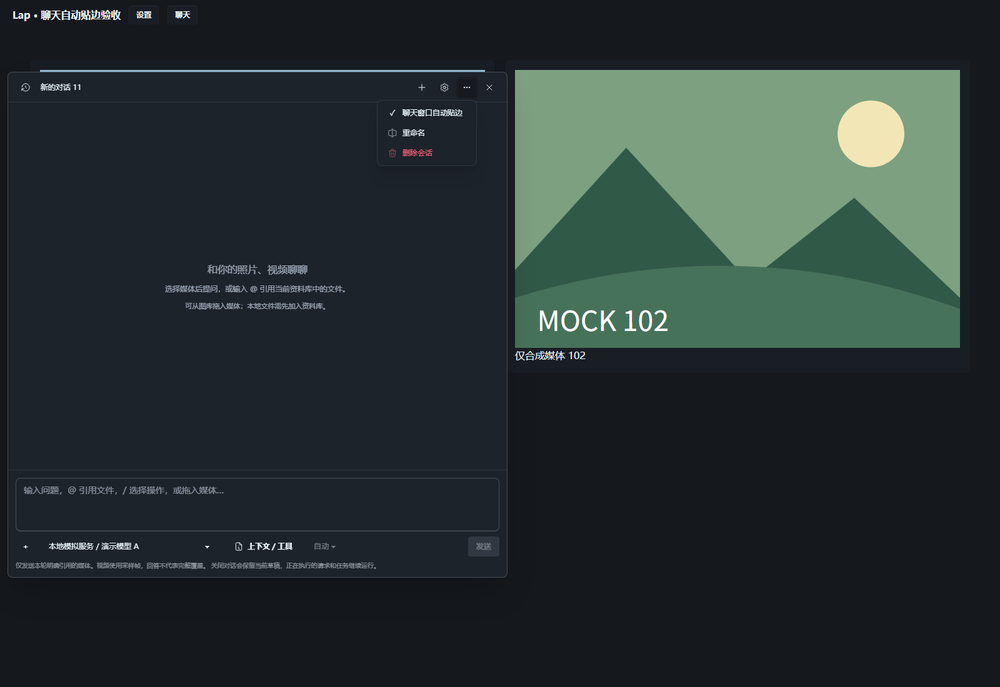

# 聊天窗口自动贴边验证

日期：2026-10-26。仅修改前端窗口布局和现有偏好设置，不改聊天协议、模型服务或媒体。未使用用户图库和真实服务。

## 行为

- `settings.mediaChat.autoDockWindow` 默认关闭；聊天 `…` 菜单与通用界面设置共用该偏好，持久化、独立设置窗口同步和备份恢复沿用既有机制。
- 开启时选择最近左／右边，等距默认右边。拖动期间自由移动，松手后重新选择贴边方向；调整聊天大小保留贴边方向。
- 本地窗口记录追加可选 `dock`：方向、纵向相对位置和用户设定的宽高。应用窗口缩放只应用这些意图，不从临时夹回视口的矩形重新推断。
- 临时窄／矮视口只限制显示，恢复后还原所设尺寸；无位移、无效方向或仅一轴改变的 resize 不覆盖其他轴的偏好。关闭贴边保留当前矩形并停止自动跟随。
- 存储恢复后才建立锚点；旧版矩形和无效记录均有兼容处理。应用窗口缩放、pointercancel、失焦沿原手势清理路径结束捕获，迟到 pointerup 不回跳。

## 自动检查

| 检查 | 结果 |
| --- | --- |
| 位置／会话／设置／备份定向测试 | 70 项通过 |
| 全量前端 Node 测试 | 1046 项通过，0 失败 |
| `pnpm build` | 通过，保留既有分包体积提示 |
| `git diff --check` | 通过 |

覆盖左右侧选择、纵向比例、窄→宽还原、无效存储、开关与自由位置、拖动换边、边框和键盘 resize、未改动轴保护、旧设置／备份恢复、等值更新和独立设置同步。本轮无 Rust 变更。

## 浏览器复验

独立 Edge／Vite 挂载实际完整 `MediaChatDialog`、嵌入式 Settings 通用页、helper 和 CSS，图库与 IPC 使用合成数据，未调用模型或业务写入。

- 默认关闭；聊天菜单与设置页双向同步，开启立即贴边。
- 右贴边随 1800×1200 视口保持 12 px 边距和纵向比例；拖至左侧后 resize 保留方向。
- 600×700 暂时压缩后恢复宽窗，可恢复手动设定的 1220×780；关闭后保持自由位置，扩大视口不自动移动。
- 重载后从实际 localStorage 恢复 dock；应用窗口缩放中断拖动，迟到 pointermove／pointerup 不回跳。
- 精确轴保护：宽 800→600 视口中只调高度至 810，再执行无位移 resize，扩大后仍恢复为 800×810。
- `window.error` 与运行异常均为 0，独立进程已清理。偏好持久化由 fixture 模拟，frame／dock 的实际 localStorage 读写已验证；该复验不等同于原生窗口实机验收。



## 复现

在 `src-vite` 执行：

```powershell
node --experimental-strip-types --test tests/mediaChatUi.test.ts tests/mediaChatDialog.test.ts tests/mediaChatPosition.test.ts tests/backupPreferences.test.ts
node --experimental-strip-types --test tests/*.test.ts tests/*.test.mjs
pnpm build
```
