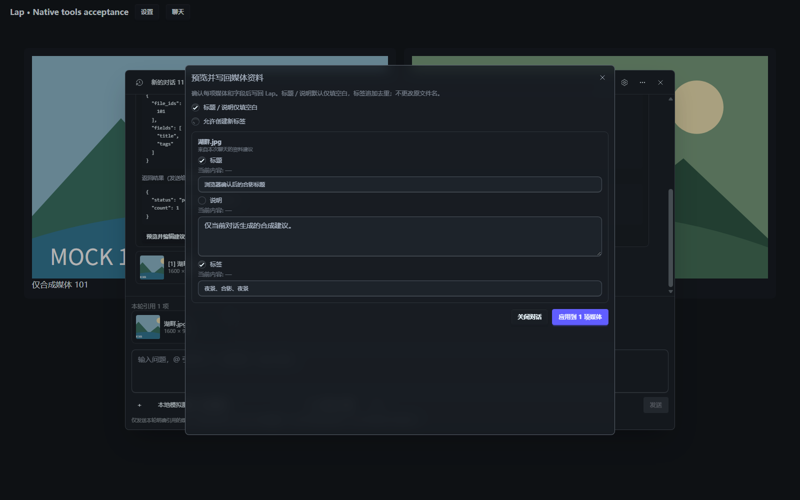

# 聊天资料建议直接采用验证

日期：2026-10-26。使用合成媒体、临时 SQLite 和回环模型服务，不读取用户密钥或操作用户原图库。

## 修复的链路

原 `propose_metadata` 必须先找到有效分析记录，即使模型已经给出了标题和标签，也返回 `analysis_missing` 并要求先启动媒体理解。前端预览和后端采用同样强制存在分析 ID，填充快捷入口还另行启动结构化理解任务。

现在完整的显式建议直接生成 `analysisId: null` 的本地预览快照，无需分析记录、JSON 分析能力检测或后台任务。已有分析仍可作为未提供完整建议时的可选来源；内容不足返回 `proposal_missing`，要求模型补齐所选字段。工具描述和每轮应用提示同步说明该流程，也覆盖自定义 system prompt。

标题、说明和标签可单独提交；直接建议按所选字段校验，不要求为未选字段编造内容。后台分析 JSON 的严格校验保持不变。聊天的三个填充快捷入口复用当前模型、媒体引用、草稿、思考强度及工具流程，关闭工具时禁用，不自动扩大权限。

工具只准备预览，用户可以编辑后确认。采用复用现有事务、资料库和可见性检查、来源版本与元数据快照冲突保护、仅填空值、标签追加和新标签开关，以及目录更新事件；不新增分析记录或改写原媒体。带分析 ID 的既有采用路径继续检查分析有效性和忽略字段。

## 自动检查

- 全量前端 Node 测试：1060 项通过，0 失败。
- 聊天相关定向测试：59 项通过。
- `pnpm build`：通过，保留既有分包体积提示。
- Rust `ai::services::` 回归：129 项通过，0 失败，1 项既有 FFmpeg 集成测试忽略。
- `cargo check --locked`：通过，保留既有未使用函数警告。
- 本次四个 Rust 模块的 `rustfmt --check --edition 2024`：通过。
- 全仓 `cargo fmt --check`：未通过，原因是未修改的 `build.rs` 及其他模块已有格式差异；未扩大变更格式化这些文件。
- `git diff --check`：通过。

前端覆盖直接建议的实际模板、编辑／采用、加载中不可采用、源变化、读取错误、切库／切会话、确认期间相同 payload 的跨会话保护、旧分析忽略字段、快捷填充无 JSON 门槛及关闭工具不越权。

Rust 新增回归覆盖无分析时准备并采用聊天标题／标签、仅部分字段、已有分析回退、标签去重／追加／创建、标题排序键、仅填空值、来源及人工修改冲突、校验失败和 SQL 写入失败回滚、旧分析忽略状态及无效分析 ID；系统提示词 HTTP 回归同时检查自定义提示词请求中的直接建议指导。

## 实际组件浏览器复验

独立 Edge／Vite 挂载实际 `MediaChatDialog`、Markdown、`ModalDialog` 和 CSS，IPC／Channel 为合成数据及记录式回调，所有媒体检查均返回 `analyses=[]`。

- `analysisId: null` 建议可进入预览，显示“来自本次聊天的资料建议”，标题、说明及标签表单可用。
- 编辑标题和标签后，确认前采用调用为 0；点击确认后仅调用一次 `media_ai_adopt`，携带 `analysisId: null`、正确的选择字段及编辑值，标签按输入分隔去重。
- 来源 `modified` 改变时拒用旧快照，采用按钮禁用。
- 选择仅有 text／image 能力且 `tested={}` 的当前聊天模型，填充标题直接调用 `media_chat_send`，保留原草稿指令和本轮引用；发送期间的新草稿保留。关闭工具后快捷入口禁用，不再发送。
- 全程 `media_ai_start_job` 调用为 0；`window.error` 和运行异常均为 0。验证进程已清理，未停止用户的开发服务。



浏览器采用为记录式 mock IPC；它与临时 SQLite／回环测试分别验证界面和后端逻辑，未代替真实供应商工具调用、原生 WebView 或用户图库实机验收。

## 复现

```powershell
cd src-vite
node --experimental-strip-types --test tests/*.test.ts tests/*.test.mjs
pnpm build
cd ..
node scripts/prepare-native-runtime.mjs
cd src-tauri
cargo test --locked ai::services:: -- --test-threads=1
cargo check --locked
rustfmt --check --edition 2024 src/ai/services/chat.rs src/ai/services/chat_tools_workflow.rs src/ai/services/store.rs src/ai/services/workflow.rs
```
