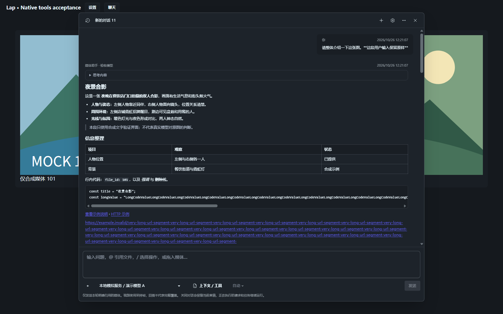

# 聊天 Markdown 渲染验证

日期：2026-10-26。仅修改前端渲染，未改聊天协议、数据库或已保存的消息。使用合成对话及隔离浏览器，没有调用真实模型、打开外部网站或处理用户媒体。

## 实现

助手正文原先通过 Vue 文本插值展示，因此 `**粗体**`、列表等标记直接出现。现由独立 `MediaChatMarkdown` 渲染，历史与流式共用；用户输入、思考文本、工具 JSON 及媒体引用卡保持原有职责。

- 使用固定版本 `markdown-it 15.0.3`，新增一个运行依赖及锁文件记录，使用其内置类型。
- 开启正文换行与明确 HTTP／HTTPS 自动链接，禁用原始 HTML；图片只生成转义后的替代文字，不生成图片资源节点。
- 链接渲染及点击时分别校验绝对 HTTP／HTTPS 地址。拦截左键、键盘与中键的默认 WebView 导航，复用已有系统浏览器打开函数；失败显示在聊天错误区域。
- 使用局部样式恢复标题、列表等 Tailwind 重置的排版。表格保留语义并在容器中滚动，长代码内部滚动、普通长文本／URL 换行，不撑宽会话。
- 初始与历史内容立即渲染，流式至多每 100 ms 合并刷新，结束／取消／失败切为非流式时立即刷新。卸载取消待执行工作。
- DOM 排版完成后通知聊天滚动；只在可见会话中跟随，关闭聊天或历史列表不修改阅读状态，向上阅读保留原位置。

## 自动检查

| 检查 | 结果 |
| --- | --- |
| Markdown／组件／聊天定向测试 | 51 项通过 |
| 全量前端 Node 测试 | 1037 项通过，0 失败 |
| `pnpm build` | 通过，保留既有分包体积提示 |
| 新 Markdown helper 的 TypeScript 检查 | 通过 |
| `git diff --check` | 通过 |

覆盖中文粗体、嵌套列表、引用、表格、代码、媒体 `[1]` 文本、跨消息引用隔离、未闭合 Markdown、长文本、危险协议、原始 HTML、图片不加载、流式合并／终态刷新／卸载、链接与打开错误、可见性与阅读位置，以及助手／用户正文接线。

## 浏览器复验

挂载实际完整 `MediaChatDialog`、Markdown 组件、helper 和 CSS，替换 IPC／Channel 与外部打开函数；使用合成消息，拦截非本地网络。

- 复现中文粗体与人物列表，标题、引用、表格和代码块均形成对应 DOM，用户／思考／工具仍为纯文本。
- 未闭合流式文本完成后正确排版；切换历史或后台完成不会串会话。在底部跟随输出，向上阅读不被拉到底部。
- 宽窗口与 600 px 视口无横向溢出，长代码／宽表格内部滚动，长 URL 换行。
- 原始 HTML／脚本／事件属性未形成活动元素，危险协议没有活动链接，图片仅有替代文字且没有 `img` 节点。
- 左键与中键仅记录模拟外部打开；当前 WebView URL 不变，点击前后没有新增页面。非本地请求、`window.error` 和运行异常均为 0。
- 独立 Edge／Vite 进程已清理。该复验不替代原生 WebView 或真实系统浏览器调用的验收。



## 复现

在 `src-vite` 执行：

```powershell
node --experimental-strip-types --test tests/chatMarkdown.test.ts tests/mediaChatMarkdown.test.ts tests/mediaChatDialog.test.ts
node --experimental-strip-types --test tests/*.test.ts tests/*.test.mjs
pnpm build
```
