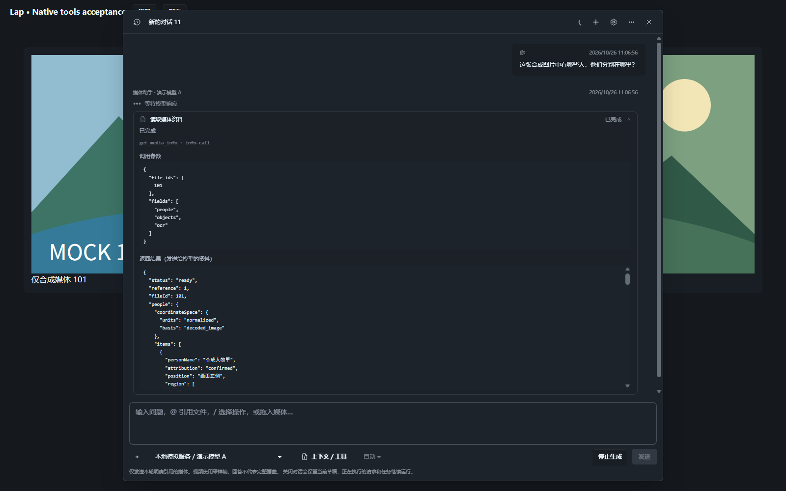
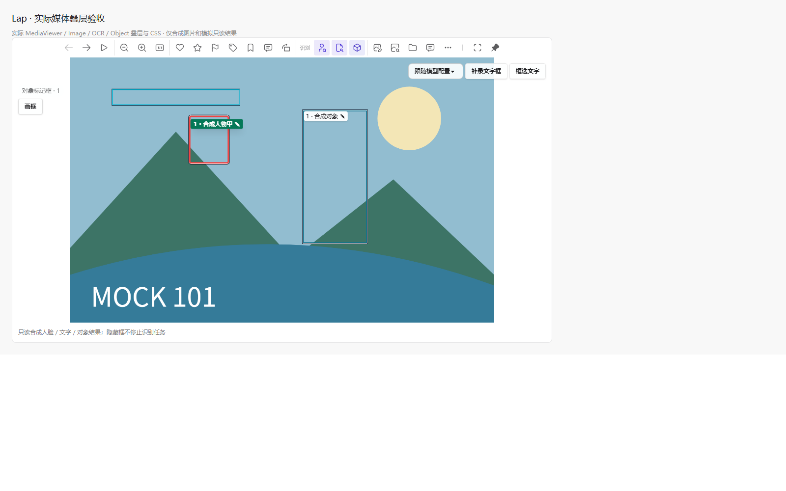
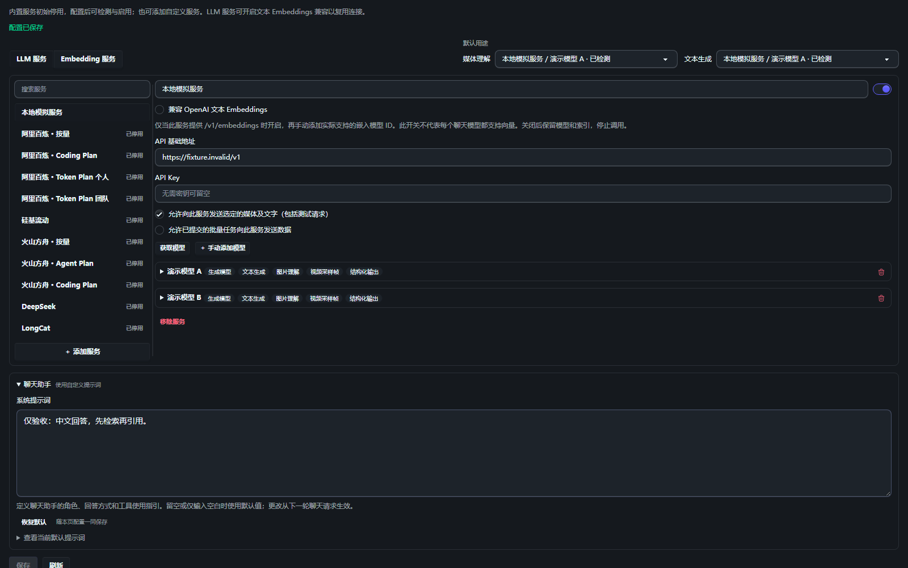
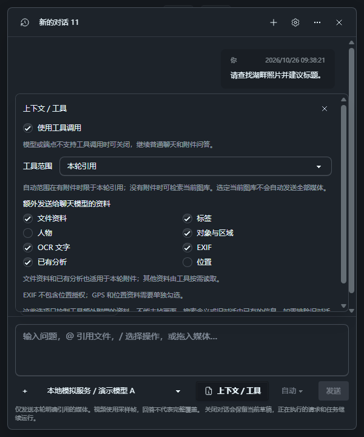
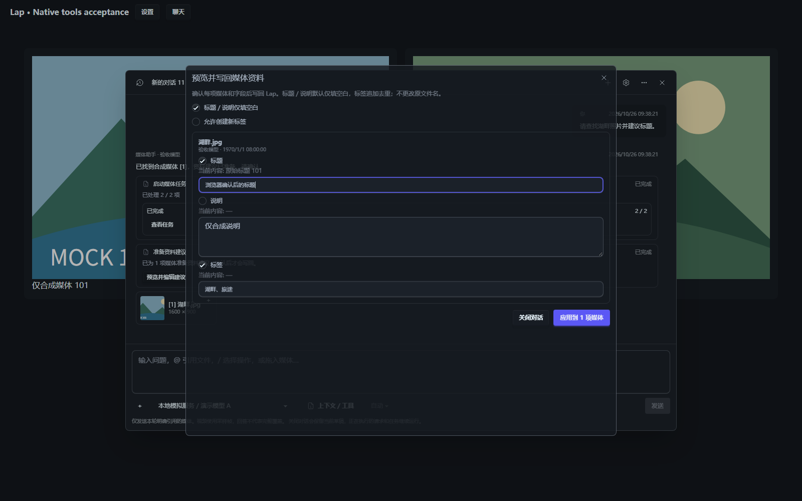

# 内置助手工具、媒体上下文与系统提示词验证

日期：2026-10-26。环境：Windows x64。使用合成媒体、临时 SQLite 和回环服务；未调用用户配置的真实模型、读取密钥或处理用户原图库。

## 已接入行为

- 注册 `search_media`、`get_media_info`、`get_media_content`、`start_media_task`、`get_media_task`、`propose_metadata` 六个工具，复用现有 Rust 业务和 genai SDK。
- 聊天请求原生工具回合完整结束后才执行，保留 call ID 与推理续接；工具结果回传后继续模型，允许纯工具回合没有正文。多工具、调用数／轮数／结果大小、取消和失败均有明确处理。
- 每次模型／Embedding 请求独立持有推理并发许可，进入工具执行前释放；同轮重复启动相同任务复用先前任务结果。
- 文件资料、标签、人物、对象、OCR、EXIF、已有分析和位置按类别返回；位置默认不共享。模型侧结果使用白名单，源路径和原始向量不会随工具资料发送。
- 图片人物区分人工确认、自动建议与未知，自动归属核对当前模型指纹。对象和 OCR 复用有效人工修订。视频人物记录不冒充完整视频人物覆盖。
- 语义搜索使用当前配置的文本／原画面索引；结构化过滤在排名前约束候选，缺少索引明确返回状态。日期字段是白名单，结果有正数上限和有限分页；扫描结束后重新检查过滤条件、来源与命中版本。
- 画面读取检查模型能力、可见性、原文件版本和云占位状态。视频限有界采样；裁剪要求明确坐标空间，旋转目录坐标不会隐式套用为解码坐标，透明 PNG 裁剪可转为 JPEG。
- 任务工具只启动理解／索引，不采用目录资料。状态由应用叠加刷新，调用记录保留执行时快照。资料建议打开现有可编辑预览，重新检查源与分析，用户确认后才调用既有采用事务。
- 设置页的“聊天助手”支持编辑、保存、查看默认和恢复默认 system prompt；旧配置及空白值沿用默认。实际提示词进入本轮模型请求和本地消息快照，不影响媒体理解 JSON 提示词或向量配置身份。
- 上下文范围、资料类别和工具开关按会话草稿暂存，发送时复制。关闭工具仍可普通聊天，旧原生工具历史转换为资料文字，不向兼容端点发送 tool 角色消息；不自动失败重发。
- 初始引用明确提供 `fileId`，附件请求和画面工具都带上已授权类别的目录摘要，无需先搜索猜测当前文件。人物保留确认／建议状态、原始人脸区域和可确认的人脸中心位置；旧旋转记录无法证明坐标对齐时明确返回位置未知。
- 目录摘要按每项媒体分配有界预算，优先压缩长说明／OCR，不再因首项资料过长丢掉整张媒体及后续引用；被压缩的类别通过 `truncatedFields` 标明，数值坐标数组保持完整。
- 工具记录展开后显示调用名称、调用 ID、JSON 参数和模型收到的 JSON 返回；执行中显示等待、失败保留错误。本地提案数据不混进返回资料，原始快照与任务实时进度仍分开。
- 查看器工具栏按实际可用宽度展开浏览、缩放、整理、识别叠层和文件操作，窄窗保留菜单。人脸／OCR／对象框可独立开关；显隐不启停识别，主窗口和独立查看窗口行为一致。

## 自动检查

| 检查 | 结果 |
| --- | --- |
| 全量前端 Node 测试 | 1004 通过，0 失败 |
| 定向前端测试 | 聊天 37 项、查看器相关 130 项；尺寸观察修复后相关 25 项通过，0 失败 |
| `pnpm build` | 通过，保留既有分包体积提示 |
| Rust `ai::services::` 测试 | 122 通过，1 项既有 FFmpeg 集成测试忽略，0 失败 |
| `cargo check --locked` | 通过 |
| 本次修改 Rust 模块格式检查 | 通过 |
| `git diff --check` | 通过 |

全仓 `cargo fmt --check` 因未修改的 `build.rs`、`main.rs`、`t_cmds.rs`、`t_sqlite.rs` 和其他模块的既有格式差异返回失败；没有扩大变更去格式化这些文件。相关 Rust 模块的单独 `rustfmt --check` 通过。

`cargo check` 仍有三个仅测试使用的兼容辅助函数和一个既有函数的未使用警告，不影响检查通过。

前端回归覆盖旧配置不制造 dirty、提示词保存与恢复、上下文／工具开关的发送快照、工具记录按 call ID 更新、最终引用、任务实时状态与历史记录分离、提案加载／编辑／采用，以及切库、切会话和旧来源拒用。

Rust 回环与领域测试覆盖分片原生工具调用、多工具、纯工具无正文、未知／重复调用、预算、取消、同轮任务去重、实际 system prompt 出站、关闭工具时的历史降级和本地数据不进入模型消息。临时 SQLite 覆盖索引配置隔离、范围内排名、迟到命中、人物来源、人工对象／OCR 修订、任务权限和提案采用冲突。通过情况以表中最终测试结果为准。

新增初始图片请求的 SDK HTTP 回环，验证即使没有工具回合，也会发送获准的人物姓名、位置和 `fileId`；取消人物字段后不发送身份。领域测试同时覆盖画面工具的授权资料、旋转坐标未知、长 OCR／说明压缩后仍保留人物与后续引用、完整坐标及截断标志。

### SDK 多工具流兼容修复

回环测试发现固定的 `genai 0.7.0` 在普通 OpenAI delta 的 `tool_calls` 数组中只处理第一项，导致同一事件中的其余调用丢失。应用通过 SDK 公开的 `raw_frame_fn` 钩子补齐按 index 交错的 ID、名称和参数片段；SDK 继续负责网络、SSE 解码、文本、思考与原生消息构造，依赖版本不变。

采集器只保留有界工具字段，结束前不执行；缺少 ID／index／名称、非法 JSON、歧义变更和超量均失败，不退化成只执行第一条。原“两工具同事件”和“十三工具批量上限”断言未放宽，修复后均通过；另有三项采集器回归。必要的 SDK 续接信息保留，应用提供的历史像素不重传，本地提案详情始终不进入模型消息。

## 真实组件浏览器复验

独立 Edge、临时 Vite 与合成数据挂载实际 `MediaAiSettings`、`MediaChatDialog`、`MediaAiBatch`、`ModalDialog` 和 CSS，仅替换 IPC／Channel 和媒体。阻断所有非本地网络请求，验收进程结束后清理。

- 实际输入自定义提示词，触发 dirty，保存请求携带文本；恢复默认后保存空值。
- 在 600 px 宽视口操作上下文面板，范围、字段和发送区均在视口内；位置初始关闭，关闭工具后字段仍可编辑。
- 原生工具增量显示任务和建议卡；真实打开既有任务面板。任务卡从 running 更新为 complete、2／2，原工具记录仍保留 running 快照。
- 从工具结果打开实际采用预览，编辑标题并明确点击采用；模拟 IPC 只在确认后收到采用参数。
- 切库时到达的旧提案不能重新打开或写回；浏览器运行时错误为 0。

该浏览器场景未连接真实 Rust IPC 或真实 GPU／模型服务。它与 Rust 的 SDK／SQLite 回归分别证明界面交互与后端逻辑，不能替代具体供应商的工具兼容性、召回质量或原生 WebView 实机验收。

### 工具详情与查看器补充复验

同样使用隔离 Edge／Vite、合成图片与模拟 IPC，阻断非本地网络，完成后清理自身进程。

- 实际聊天工具记录默认折叠，展开显示名称、call ID、入参和返回 JSON；从 running 到 completed 保持展开并更新结果。失败、空返回及等待状态清晰，HTML 文字转义，`localData` 不显示。
- 600 px 聊天窗口包含 16 KB 连续长字段时无横向溢出，返回区限高滚动。
- 实际 `MediaViewer`、`TButton` 和 `ContextMenu` 在 1100／600／400 px 宽度及 600 px 视口下无按钮越界；独立查看器模式在 1000／600 px 宽度为窗控留出空间。
- 实际挂载 `Image.vue`、`FaceNameEditor`、`OcrImageOverlay`、`OcrRegionTool` 和 `ObjectImageOverlay`，只替换合成媒体与只读识别数据。三类框／人物标签均有正面积，点击工具栏按钮可分别隐藏并恢复，`aria-pressed` 同步；没有触发任务启停或资料写入调用。
- 尺寸观察回调同步变更分组曾触发 `ResizeObserver` 未交付通知，已改为下一帧合并应用尺寸并在卸载时取消。最终宽窄复验的 `window.error` 与运行异常均为 0，没有过滤该错误。











## 复现

在 `src-vite`：

```powershell
node --experimental-strip-types --test tests/*.test.ts tests/*.test.mjs
pnpm build
```

在仓库根目录准备原生桥接，然后从 `src-tauri` 执行：

```powershell
node scripts/prepare-native-runtime.mjs
cd src-tauri
cargo test --locked ai::services:: -- --test-threads=1
cargo check --locked
```

实现说明见 [内置助手工具调用设计](../lap-assistant-capabilities.md)，用户操作见 [媒体理解指南](../../media-understanding.md)。
