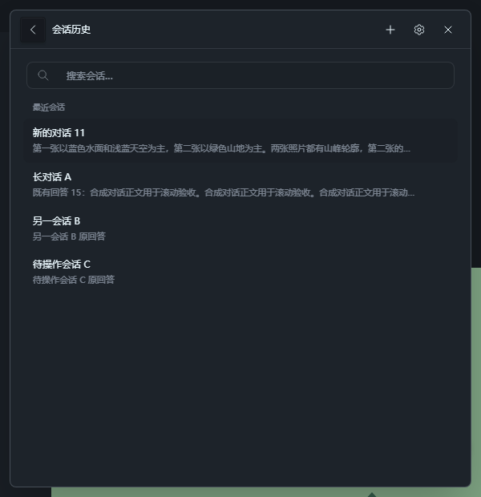
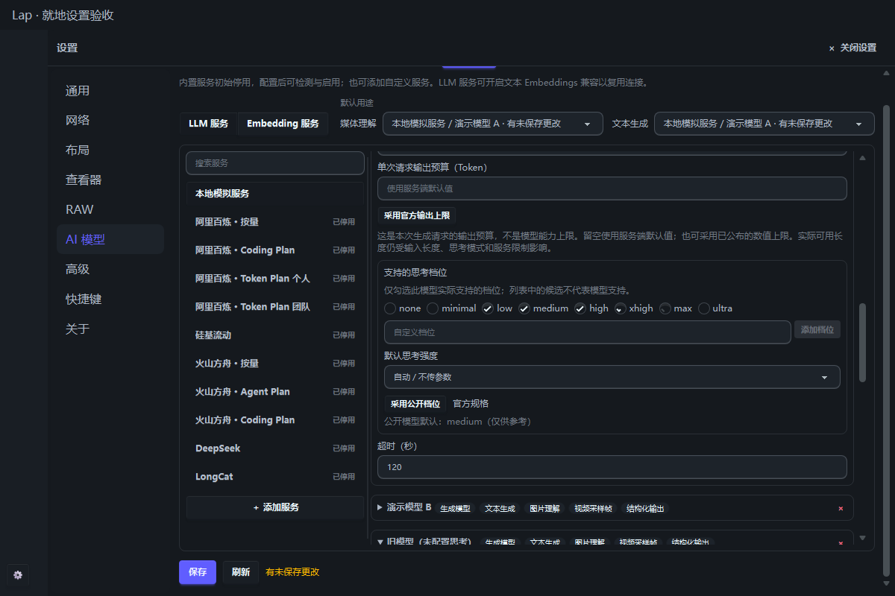
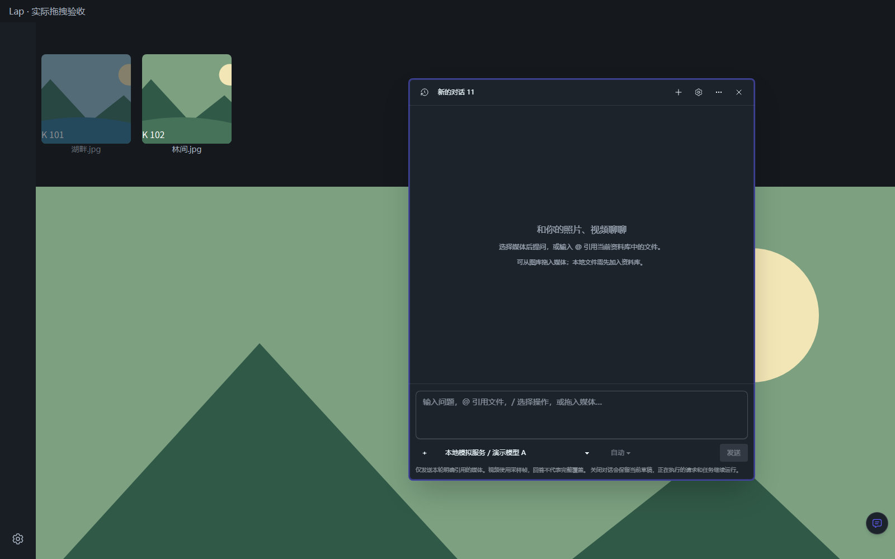
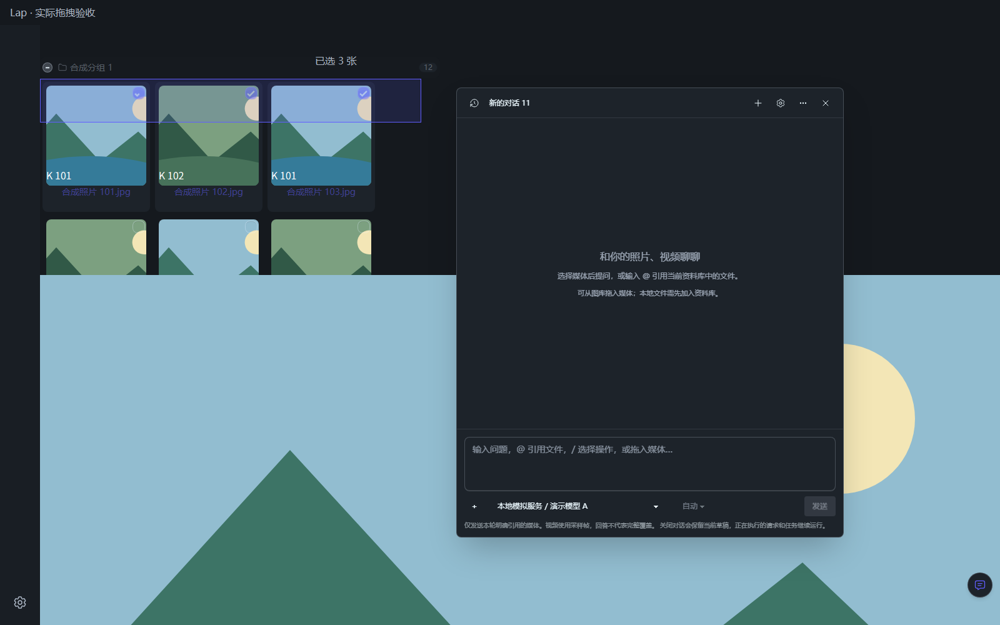

# 媒体会话验证

日期：2026-10-25。环境：Windows x64。使用临时 SQLite、合成媒体和回环模拟服务；未读取真实密钥或请求用户配置的模型。

2026-10-26 新增的原生工具调用、可配置系统提示词和上下文选项见[工具与提示词验证](media-chat-tools.md)。

## 功能与数据

- 图库悬浮按钮和查看器工具栏打开当前窗口的媒体会话。信息面板、多选面板和自然语言搜索页撤下旧理解入口。
- 会话、消息状态、引用和模型快照保存到当前图库。关闭对话不取消请求；切换图库关闭对话，异步结果不能带入新库／新会话。
- 顶部图标提供会话历史、新会话、设置及当前会话菜单。历史采用可搜索列表，每行菜单绑定独立会话；默认空会话首问接受时原事务内生成短标题，后问和手动标题不覆盖。用户消息靠右，助手回复靠左。
- 发送后立即显示本地消息和等待状态，通过 Tauri Channel 接收三 ID、单调序号和真实正文／思考增量。重复、跨会话和终态后的帧不覆盖当前结果；正文开始后保持生成状态，交错的思考片段仍原样保存。
- Rust 使用既有 genai SDK 的 `exec_chat_stream` 消费真实 SSE，不伪造字符流。50 ms 批量交付增量、500 ms 数据库检查点，结束时强制保存；取消／失败／进程中断保留部分内容。UI Channel 断开不取消已接受请求，异常 EOF 不标为完成，也不自动重发非流请求。
- 用户离开底部阅读时保持滚动位置，显示“新内容”入口；思考面板仅显示接口返回的内容。立即停止会在首个已登记反馈到达后补发幂等取消，避免请求登记前的取消丢失。
- 每轮明确附加最多 16 项媒体，支持 `@` 检索和图库内部拖入。外部拖入只按当前图库完整路径关联，不猜测同名文件或导入原件。
- 消息和本轮附件显示缩略图摘要卡，点击通过现有查看器打开详情；历史视频引用带入片段起点。移除右侧会话媒体列表和顶部模式下拉，模型、思考强度及发送放在输入区，任务收进 `＋`／`/` 菜单。
- 四边和四角均可拖动缩放，固定对边并夹紧视口；支持键盘调整，结束／取消／失焦／卸载清理指针捕获和监听。
- 聊天作为非模态窗口，不阻断主窗设置入口或图库鼠标。主窗设置导航成功后才收起聊天，取消时保留草稿；独立查看窗配置入口继续先收起本窗聊天。
- 图库单项／多选复用原内部拖放路由；大图观察现有指针手势，只有落到聊天时才添加真实媒体引用、清理图片平移并还原起拖视口。普通图内平移和向窗口外拖出仍保留，聊天目标优先于窗口边缘的原生拖出；切库、切文件、版本变化和取消不会错误附加。
- 网格空白处和缩略图间隙支持左键框选，Ctrl／Command／Shift 追加，边缘自动滚动；选择复用现有 ID 集合、计数和分组统计。Esc、失焦或取消恢复原选择，切库／改布局／卸载清理选框和监听。松手后补齐虚拟占位媒体，补齐中暂不启动拖放，避免导出部分选择；新选择操作使旧补齐结果失效，分组加载不完整会提示错误。
- 模型设置可声明标准／自定义思考档位和默认值。每轮可继承模型默认、明确自动省略参数、或指定白名单内档位；真实 HTTP 检查 `reasoning_effort` 的精确值、默认省略和 SDK 不改写 Model ID。旧配置不制造 dirty，旧哈希与旧消息兼容，Embedding 不接受思考配置。
- 会话模型覆盖只用于本次问答、资料建议或理解任务，不修改默认用途；Embedding 继续使用原有配置。
- 交互聊天按已声明能力、服务启用和传输许可选择模型，不再用逐项检测回执隐藏模型。无回执或仅检测过视频的图片模型可直接显式尝试；不会伪造回执，也不会绕过资料建议、批量处理及 Embedding 的检测要求。
- 标题、说明和标签先生成建议，逐项编辑并确认写回。忽略字段不可采用，后端保留来源版本、可见性和元数据冲突检查，原分析及原文件不被改写。
- 浮动入口使用圆形纯图标，保留无障碍名称与悬停提示，支持显示开关、默认四角位置、拖动记忆和重置。对话框可移动、缩放并记忆尺寸；建议预览固定在视口内，异步内容在内部滚动。

## 自动验证

| 检查 | 结果 |
| --- | --- |
| 全量前端 Node 测试 | 990 通过，0 失败 |
| `pnpm build` | 通过，保留既有分包体积提示 |
| Rust `ai::services::` 测试 | 90 通过，1 项既有 FFmpeg 集成测试默认忽略 |
| `cargo check --locked` | 通过 |
| 本次 Rust services 模块格式检查 | 通过 |
| `git diff --check` | 通过 |

本次拖入高亮与框选修复重新执行前端 Node 测试、构建和 diff 检查；未改 Rust，表中 Rust 结果沿用同日此前的验证。

Rust 回归覆盖 SQLite 关闭重开、资料库隔离、不可见／已替换来源、真实多轮 HTTP 消息、临时模型选择、失败和取消落库、中断恢复及引用编号。前端覆盖真实 SFC 的会话操作、附件异步切换、建议编辑、忽略字段、预览尺寸、内部拖拽、设置恢复和中英文 `@` 文案运行时编译。

流式回归使用真实 TCP SSE 分包和实际 SDK，覆盖正文／思考增量、有序 Channel、700 ms 时读取 pending 检查点、无思考／无 Channel、视图断线、异常 EOF／JSON／供应商错误／输出上限、权限撤销和 500 ms 检查点前的早取消。失败和取消均保留部分内容；旧快照与中断恢复兼容，交错增量不会绕过事件节流。默认首问标题与高频检查点的库／会话／请求隔离也在回归内。

后续复验覆盖图片模型仅有文本／视频回执、以及完全没有检测回执的两种配置，均能通过显式聊天请求发送；请求不制造检测回执，不要求 JSON 回答。浏览器中确认两种模型都能附图发送，而禁用服务、撤销传输许可或移除图片能力仍禁止发送；资料建议保留检测要求。悬浮按钮实际为 40×40，按钮无可见文字，保留无障碍名称和提示。

全仓 `cargo fmt --check` 仍因既有 `build.rs`、`main.rs` 和其他模块的格式差异失败；没有扩大本次变更去格式化这些文件。

## 复现与边界

在 `src-vite` 执行：

```powershell
node --experimental-strip-types --test tests/*.test.ts tests/*.test.mjs
pnpm build
```

在 `src-tauri` 执行：

```powershell
cargo test --locked ai::services:: -- --test-threads=1
cargo check --locked
rustfmt --check --edition 2024 --config skip_children=true src/ai/services/chat.rs src/ai/services/client.rs src/ai/services/mod.rs src/ai/services/stream_fixture.rs
```

浏览器交互使用实际 Vue 源组件及模拟 IPC，检查模型覆盖、图像／视频引用、会话草稿、编辑建议后采用、窗口移动缩放、悬浮入口拖动及设置。600×620 视口下，对话及建议预览均为 `(12, 12, 576, 596)`；建议加载后可在内部滚动到确认按钮，编辑后实际发出 3 项采用请求。没有横向溢出或浏览器运行时错误。

本轮布局复验共 14 个阶段：真实指针拖动四边及两个角；缩略图解码、卡片详情与小加号分离；`@`／`/` 菜单；每轮 `null`／空串／显式档位发送及切模型重置；设置勾选、默认移除与公开档位采用后保存。600×620 下模型、思考强度、菜单和发送均在视口内。浏览器中的详情 helper 只记录媒体 ID／片段起点，不打开用户原件；实际 helper、主窗口快照、查看器信息面板及延迟视频 seek 由单元回归覆盖，连续点击产生的过期查询不会重新打开较早媒体。原生跨窗口点击仍由用户确认。

历史／流式 UI 的真实 SFC 与模拟 Channel 浏览器复验覆盖逐行重命名／删除／搜索、即时双气泡、阶段与增量、重复／错 ID 帧、停止／失败部分内容、关闭重开与切换会话、历史页拖入和 600 px 末行菜单。真实滚轮离底后新增量保持 `scrollTop 345 → 345`；终态替换服务器消息 ID 后仍为同一 DOM 节点，思考面板展开状态保留，正文无重复，`scrollTop 860 → 860`，点击“新内容”回底。实际 JS Channel 的 `__CHANNEL__:` 序列化、乱序原始帧重排及结束清理另经独立检查；未替代原生 WebView 端到端验收。

设置／拖入修复复验挂载真实 GridView、VirtualScroll、Thumbnail、MediaViewer、Image、Chat、Settings 和 TButton，使用逐字提取的 Home／Content 路由函数；只有 IPC、媒体、拖拽 ghost 绘制和非聊天业务操作使用 fixture。实际鼠标完成图库单项／多选和大图拖入，图片落下前后视口严格相等，普通平移仍改变视口；点击左下角设置图标或配置服务均显示设置并隐藏聊天，返回后草稿保留。原生文件拖出、其他业务写操作和浏览器异常均为 0。该验证不调用真实模型或读取用户原件。

拖入高亮复验额外逐字提取 `setPointerDropTarget`／`removeDragGhost`：鼠标保持按下并悬停聊天时，实际计算背景 alpha 为 255、opacity 为 1；仅高亮边框和内描边，背景不被 `!bg-primary/10` 覆盖。移出后在外松开不会添加引用，再次拖入并放下正常附加；两条路径均清除目标高亮及拖拽预览。

框选复验挂载真实网格组件，使用 24 张合成媒体、两组标题、三列和 400 px 高视口；生产 `beginBoxSelection`／`updateBoxSelection`／`finishBoxSelection`、`setItemSelected` 及拖放路由逐字提取。真实鼠标覆盖空白与间隙起拖、正反向框选、Ctrl 追加、Esc 恢复、底部空白及按住鼠标滚动跨视口。选择由 6 项扩到 15 项，分组计数为 12／3；松手后 Set、媒体标记和总计一致。再从可见已选缩略图拖入聊天，接收的引用恰为完整 15 个 ID，未进入文件操作或原生拖出路径。该浏览器场景使用已加载的合成记录；Node 回归额外覆盖异步占位补全、库／查询／列表过期、补全时禁止拖走子集、完成后两路完整拖放、新选择使旧补全失效及分组空／短响应提示。

下图为真实组件截图，媒体名称及回答为合成验收数据：










浏览器验证证明组件交互及请求参数，不代表真实模型效果或原生系统拖入验收。用户运行中的开发版已自动重新编译并重启；最终外观和真实模型推理由用户在 Lap 中确认。
