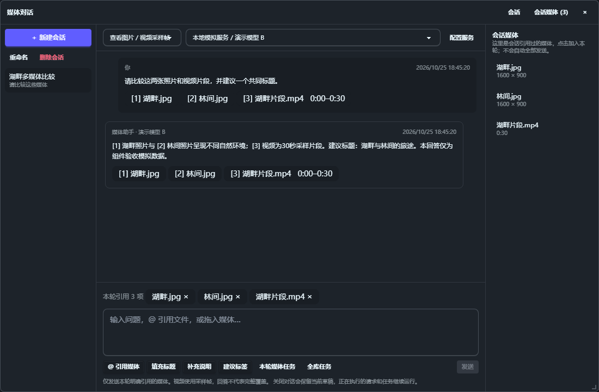

# 媒体会话验证

日期：2026-10-25。环境：Windows x64。使用临时 SQLite、合成媒体和回环模拟服务；未读取真实密钥或请求用户配置的模型。

## 功能与数据

- 图库悬浮按钮和查看器工具栏打开当前窗口的媒体会话。信息面板、多选面板和自然语言搜索页撤下旧理解入口。
- 会话、消息状态、引用和模型快照保存到当前图库。关闭对话不取消请求；切换图库关闭对话，异步结果不能带入新库／新会话。
- 每轮明确附加最多 16 项媒体，支持 `@` 检索和图库内部拖入。外部拖入只按当前图库完整路径关联，不猜测同名文件或导入原件。
- 会话模型覆盖只用于本次问答、资料建议或理解任务，不修改默认用途；Embedding 继续使用原有配置。
- 标题、说明和标签先生成建议，逐项编辑并确认写回。忽略字段不可采用，后端保留来源版本、可见性和元数据冲突检查，原分析及原文件不被改写。
- 浮动入口支持显示开关、默认四角位置、拖动记忆和重置。对话框可移动、缩放并记忆尺寸；建议预览固定在视口内，异步内容在内部滚动。

## 自动验证

| 检查 | 结果 |
| --- | --- |
| 全量前端 Node 测试 | 922 通过，0 失败 |
| `pnpm build` | 通过，保留既有分包体积提示 |
| Rust `ai::services::` 测试 | 79 通过，1 项既有 FFmpeg 集成测试默认忽略 |
| `cargo check --locked` | 通过 |
| 本次 Rust services 模块格式检查 | 通过 |
| `git diff --check` | 通过 |

Rust 回归覆盖 SQLite 关闭重开、资料库隔离、不可见／已替换来源、真实多轮 HTTP 消息、临时模型选择、失败和取消落库、中断恢复及引用编号。前端覆盖真实 SFC 的会话操作、附件异步切换、建议编辑、忽略字段、预览尺寸、内部拖拽、设置恢复和中英文 `@` 文案运行时编译。

全仓 `cargo fmt --check` 仍因既有 `build.rs`、`main.rs` 和其他模块的格式差异失败；没有扩大本次变更去格式化这些文件。

## 复现与边界

在 `src-vite` 执行：

```powershell
node --experimental-strip-types --test tests/*.test.ts tests/*.test.mjs
pnpm build
```

在 `src-tauri` 执行：

```powershell
cargo test --locked ai::services:: -- --test-threads=1
cargo check --locked
rustfmt --check --edition 2024 --config skip_children=true src/ai/services/chat.rs src/ai/services/client.rs src/ai/services/requests.rs src/ai/services/workflow.rs src/ai/services/store.rs src/ai/services/mod.rs
```

浏览器交互使用实际 Vue 源组件及模拟 IPC，检查模型覆盖、图像／视频引用、会话草稿、编辑建议后采用、窗口移动缩放、悬浮入口拖动及设置。600×620 视口下，对话及建议预览均为 `(12, 12, 576, 596)`；建议加载后可在内部滚动到确认按钮，编辑后实际发出 3 项采用请求。没有横向溢出或浏览器运行时错误。

下图为真实组件截图，媒体名称及回答为合成验收数据：



浏览器验证证明组件交互及请求参数，不代表真实模型效果或原生系统拖入验收。用户运行中的开发版已自动重新编译并重启；最终外观和真实模型推理由用户在 Lap 中确认。
