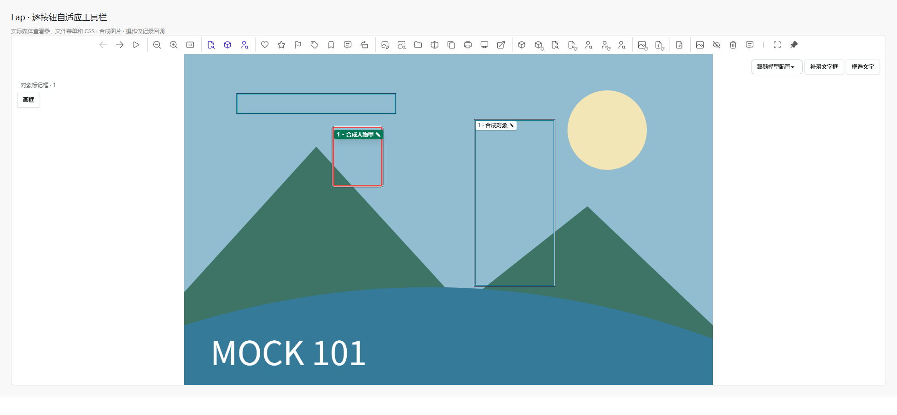

# 查看器逐项自适应工具栏验证

日期：2026-10-26。本轮仅修改前端工具栏、原文件菜单的稳定标识／图标及菜单卸载清理，无新增依赖或 Rust 变更。

## 行为

- 按每个按钮的真实宽度、分组分隔、边距和间距逐项排布；空间足够时展示全部候选操作，仅将放不下的项收进“更多”。窗口加宽后自动展开。
- 复用原文件菜单回调和禁用条件；评分、选片、外部应用等选择项保留一个菜单按钮。识别与重新识别分别保留，重新执行项带刷新角标。
- 媒体右键使用独立的完整菜单，不随工具栏可见项减少。独立／对比查看器只展示其实际支持的操作。
- 固定按钮区、窗口控制按钮和图标占位均实测；文件名使用剩余空间截断。取消小于 600 px 时隐藏整条工具栏的旧样式。
- 菜单因窗口缩放卸载时同步释放打开状态，取消异步打开、监听和子菜单定时器；测量经动画帧合并，避免 ResizeObserver 更新循环。

## 自动检查

| 检查 | 结果 |
| --- | --- |
| 工具栏布局／原动作／菜单生命周期定向测试 | 16 项通过 |
| 全量前端 Node 测试 | 1056 项通过，0 失败 |
| `pnpm build` | 通过，保留分包体积及插件耗时提示 |
| `git diff --check` | 通过 |

覆盖逐项伸缩、More 占位、动作不丢失／不重复、原回调身份、父子禁用、独立查看器白名单、真实模板渲染、幻灯片间隔更新、大字号标题预算及菜单卸载的异步边界。

## 浏览器复验

独立 Edge／Vite 挂载实际 `MediaViewer`、`Image`、`TButton`、`ContextMenu`、文件菜单、布局 helper 和项目 CSS。媒体为合成图片／RAW 预览，识别数据为只读 fixture，操作回调仅记录；未使用用户图库、原生后端或执行真实识别、删除、外部打开及业务写入。

- 查看区宽 1900／1600 px 时，34 个候选操作全部直显，没有“更多”；包括重命名、复制、打印以及 6 个识别／重新识别操作。
- 41 个每次缩窄 24 px 的样本按按钮逐项收纳；“更多”仅包含溢出操作，完整媒体右键仍包含已直显操作。
- 独立查看器宽窗展示 20 个支持的候选操作；600 px 场景保留单行并避让窗口控件，禁用项不执行。
- “更多”打开后加宽至全部可见、评分菜单打开后收窄至折叠，菜单均随卸载关闭，移开鼠标后悬浮工具栏可正常隐藏。
- 幻灯片模式可选 1／3／5／10／15／30 秒，选择 15 秒后共享设置和按钮文字同步更新；固定浏览区由 104 增至 144 px 时，候选按钮由 19 减至 18，仍保持单行且无横向溢出。
- 独立查看器使用 24 px 根字号及长文件名时，标题与首按钮保留 4 px 间距，末按钮与窗口控件保留 8 px 间距，均无重叠或横向溢出。
- RAW 预览工具区与悬浮工具栏避让正常。`window.error`、运行异常和 ResizeObserver 错误均为 0。



以上是实际前端组件的浏览器验证，不等同于原生窗口及真实文件操作验收。独立验证进程已清理，未停止用户的开发服务。

## 复现自动检查

在 `src-vite` 执行：

```powershell
node --experimental-strip-types --test tests/viewerToolbar.test.ts tests/viewerToolbarLayout.test.ts tests/contextMenuLifecycle.test.ts
node --experimental-strip-types --test tests/*.test.ts tests/*.test.mjs
pnpm build
```
