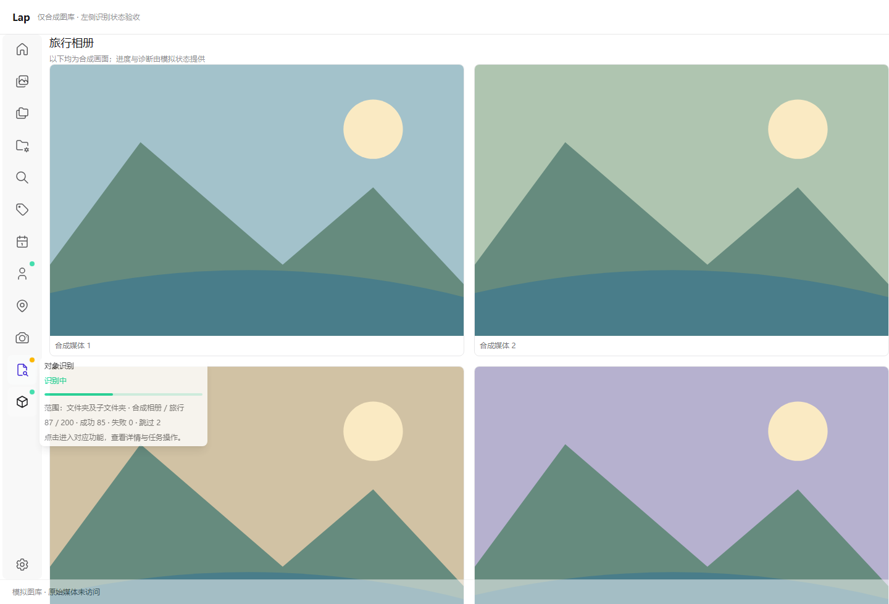

# 侧边栏识别状态验证

日期：2026-10-26。范围：主窗口人脸、对象与 OCR 的后台状态展示。未修改 Rust、识别算法、任务调度或数据库；未处理用户媒体。

## 行为

- 移除主窗口右下角对象／OCR 识别卡的挂载，人脸完成事件保存诊断但不再弹出普通完成／错误状态 Toast。
- 左侧对应入口显示闪动绿点或常亮黄点，减少动态效果时绿点不闪。正常完成、主动停止和没有错误的手动暂停无故障点；失败、部分失败及对象任务历史中断显示黄点。
- 悬停／键盘聚焦显示阶段、范围、进度与错误，任务更新时持续刷新。状态详情独立于普通提示开关，不自动超时关闭；离开、失焦或 Esc 关闭。点击保留导航行为，任务操作仍在对应工作区。
- 复用对象／OCR 的共享状态和订阅，不因移除卡片中断监听。人脸在主窗口独立订阅进度／聚类／结束事件并只读轮询，先订阅再恢复运行，处理查询与事件竞态、切库、模型变更和异步卸载。
- 人脸首次空闲快照可恢复应用会话中已保存的当前库诊断，后续新任务不会重新冒出旧错误；零人脸、质量过滤等正常结果不会直接成为故障黄点。

## 自动检查

| 检查 | 结果 |
| --- | --- |
| 新增定向测试 | 19 项通过 |
| 全量前端 Node 测试 | 1023 项通过，0 失败 |
| `pnpm build` | 通过，保留既有分包体积提示 |
| `git diff --check` | 通过 |

定向测试覆盖状态判定、准备／识别／聚类的不同进度、提交请求不复用旧任务 100% 和范围、实际错误与普通暂停的区别、旧库拒用、人脸迟到查询和完成事件竞态、启动前诊断恢复、订阅失败保留、轮询／监听清理、真实按钮模板、提示设置／超时、焦点与 Escape，以及主窗口挂载和人脸完成通知接线。

浏览器验收使用实际 Vue 组件、CSS 和主窗口导航模板，合成任务状态与模拟 IPC；结果不代表真实模型推理或原生 WebView 的验收。

## 浏览器复验

- 挂载实际 Home 的 `visibleButtons` 导航模板、`RecognitionSidebarButton`、`TButton`、状态 helper 与 CSS，背景和任务均为合成数据。
- 三类任务运行时绿点使用 pulse，完成后消失。对象历史中断即使没有错误字符串也显示黄点，OCR 失败与人脸真实诊断失败同样显示黄点。
- 鼠标悬停、Tab 聚焦均显示任务详情；42→87 的计数持续刷新，超过原 3 秒自动隐藏时长仍保持。Escape／离开关闭，点击或 Enter 保留导航，没有任务启停请求。
- 全局普通提示关闭时，状态详情仍显示，普通空闲按钮的提示仍遵守原设置。
- 请求提交期间不复用旧快照的 `100/100` 或旧范围，进度保持未知；收到 running 状态后同一提示更新为本次进度。
- 1440 px 与 600 px 视口内无横向溢出；`window.error`、运行异常和业务 IPC 调用均为 0。独立 Edge／Vite 进程已清理。



## 复现

在 `src-vite` 执行：

```powershell
node --experimental-strip-types --test tests/recognitionStatus.test.ts tests/faceRecognitionStatus.test.ts tests/recognitionSidebarButton.test.ts
node --experimental-strip-types --test tests/*.test.ts tests/*.test.mjs
pnpm build
```

使用说明见[识别状态提示](../../recognition-status.md)。
