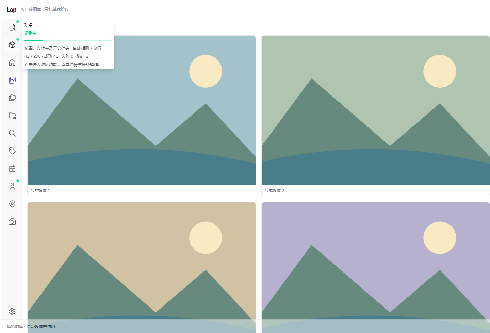

# 侧栏导航排序验证

日期：2026-10-26。本次仅修改前端导航及界面偏好，不修改识别任务、图库数据或原媒体，不新增依赖。

## 行为

- 最左侧导航图标可直接拖动排序，也可右键选择上移、下移或恢复默认顺序；设置按钮留在底部，不参与排序。
- 顺序保存到全局 `settings.sidebarOrder`，沿用配置持久化、窗口同步及设置备份恢复。导航仍使用稳定的 `SIDEBAR` ID，调整位置不会更改当前页面或图标对应的功能。
- 关闭人脸功能只隐藏人物入口，完整顺序保留该 ID；恢复显示后不会被当作新增按钮追加到末尾。旧配置、缺项、重复及未知 ID 会规范化并补齐默认项。
- 拖动过程中收起提示浮层，状态点和进度仍按导航 ID 绑定；松手不触发导航或设置按钮。Escape、失焦、指针取消及切换图库会取消拖动，取消／卸载清理本导航的浮动克隆及拖拽实例。
- 复用已有 `vue-draggable-plus`。程序化销毁会遗漏的 fallback 克隆使用唯一类名限定清理范围；右键菜单通过已有惰性输入读取当前目标，避免首次打开使用旧的禁用状态。

## 自动检查

| 检查 | 结果 |
| --- | --- |
| 最终全量前端 Node 测试 | 1074 项通过，0 失败 |
| `pnpm build` | 通过，保留既有分包体积及插件耗时提示 |
| `git diff --check` | 通过 |

覆盖真实模板渲染、拖动写入稳定 ID、首尾及隐藏项移动、右键边界和恢复默认、首开菜单最新状态、拖后点击保护、取消后的迟到事件、专属克隆清理及卸载、状态提示和焦点、旧配置规范化、备份恢复。实际 Pinia／持久化插件配合内存 Storage 验证新实例重载，以及独立设置窗口接收新顺序后再次保存不会覆盖该顺序。无 Rust 变更。

## 浏览器复验

隔离 Edge／Vite 挂载实际 Home 侧栏模板、排序／拖动／取消／菜单代码、`VueDraggable`、状态按钮、`TButton`、`ContextMenu`、顺序 helper 和项目 CSS，使用合成图库。

- 实际鼠标将 OCR 拖到首位、对象识别拖到第二位；顺序保存，拖动不触发导航，后续普通点击仍可导航。状态点及悬停进度按 ID 跟随图标。
- Escape 取消后，迟到的移动／松手不改变顺序、导航或持久化；body 无残留 fallback 克隆，后续拖动可正常执行。
- 首次右键读取当前按钮的正确上移／下移边界，移动和恢复默认均可执行。设置按钮不在排序列表中。
- 隐藏再开启人物入口保留其完整顺序；浏览器重载后恢复 `[9,10,11,...]` 的已保存顺序。
- 600×420 视口下导航可滚动，未出现横向溢出；运行异常及 `window.error` 均为 0，验证进程已清理，未停止用户开发服务。

导航、任务和焦点为记录式 fixture；配置使用生产 `setSidebarOrder` 源码及响应式状态，由 fixture watch 记录持久化并写入专用 localStorage，实际浏览器重载已验证。生产 Pinia、跨窗同步和备份由上面的自动测试覆盖，未在本次浏览器场景内调用。未操作用户图库、真实任务或原生 WebView。



## 复现自动检查

在 `src-vite` 执行：

```powershell
node --experimental-strip-types --test tests/sidebarNavigation.test.ts tests/sidebarOrder.test.ts tests/recognitionSidebarButton.test.ts tests/backupPreferences.test.ts
node --experimental-strip-types --test tests/*.test.ts tests/*.test.mjs
pnpm build
```
