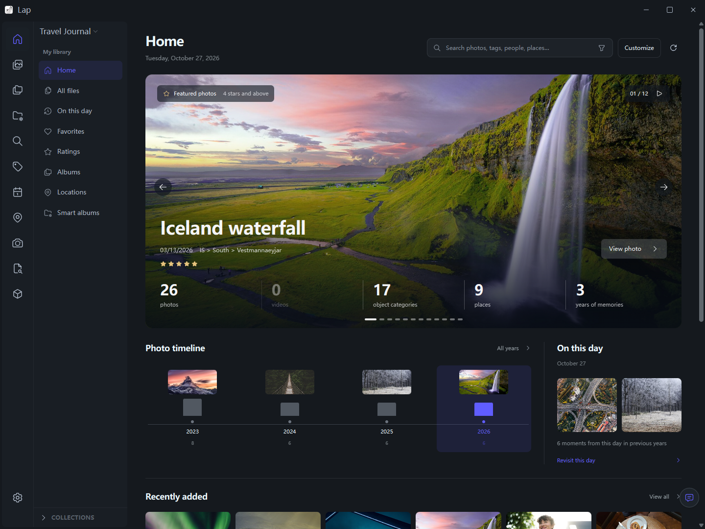
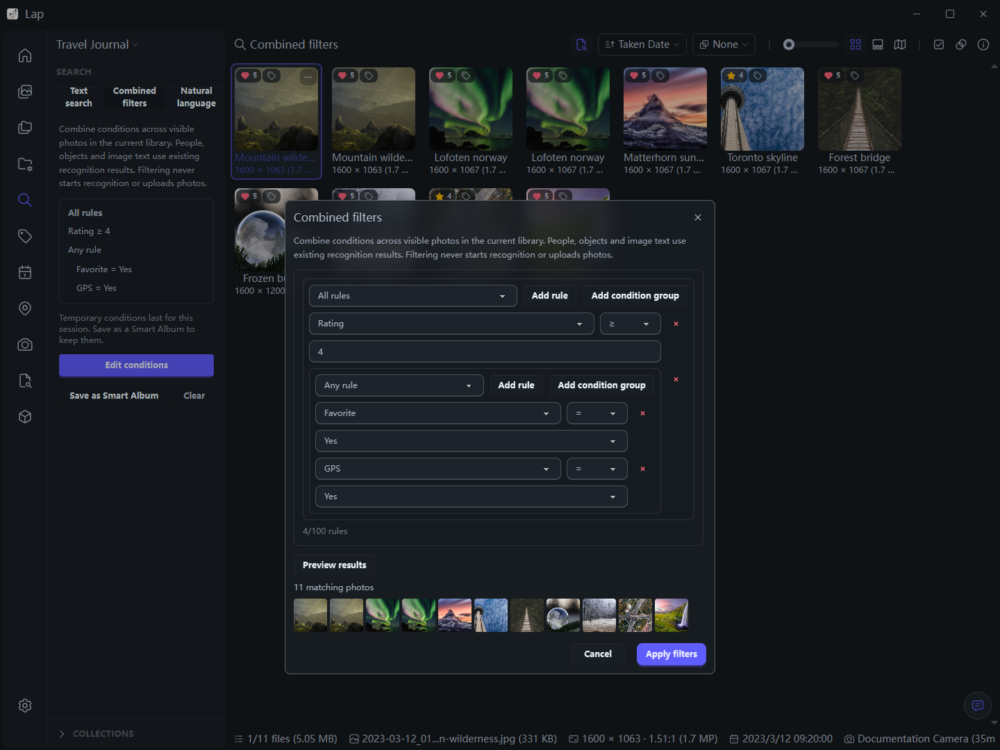
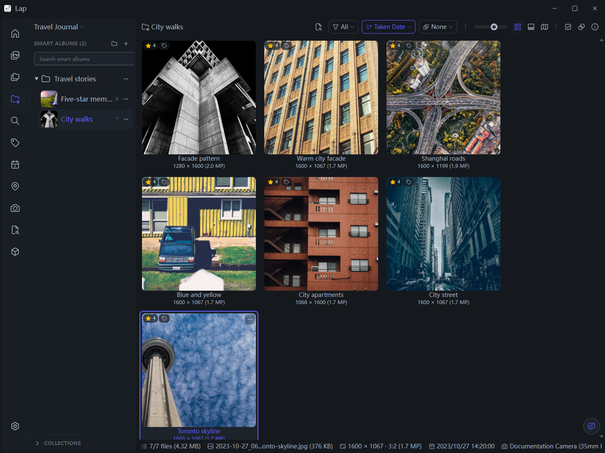
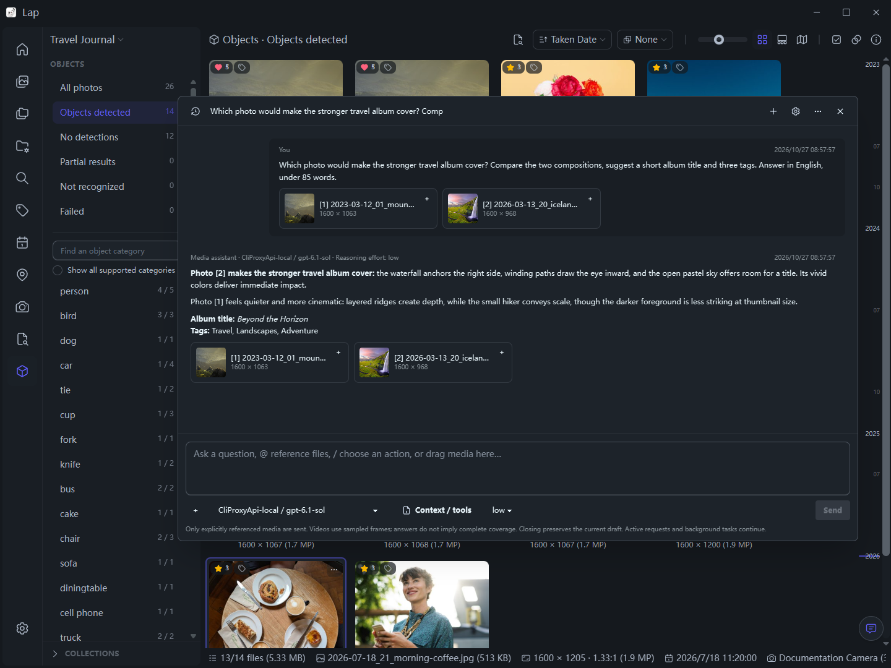
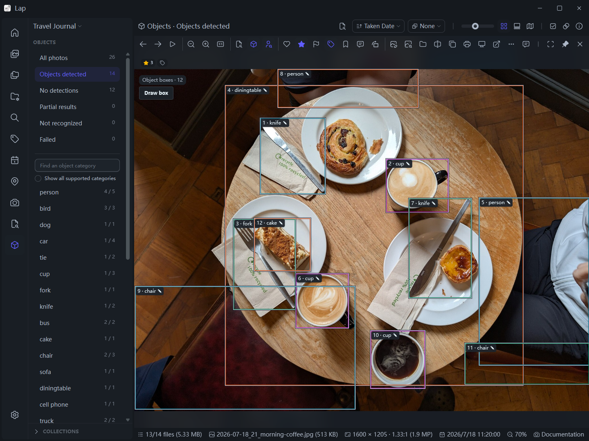
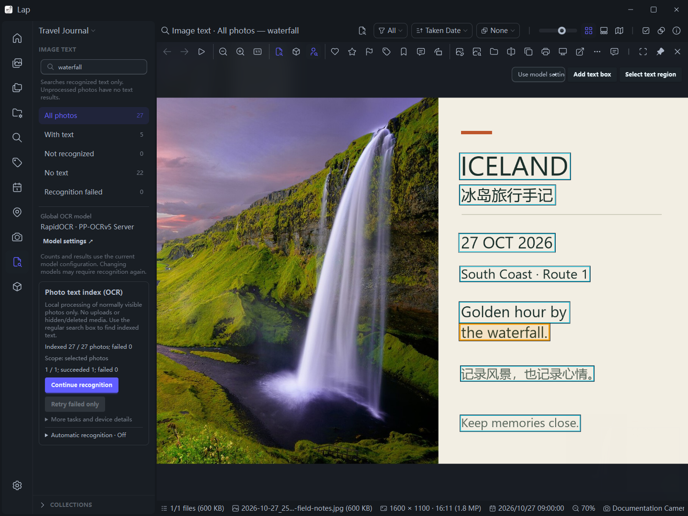
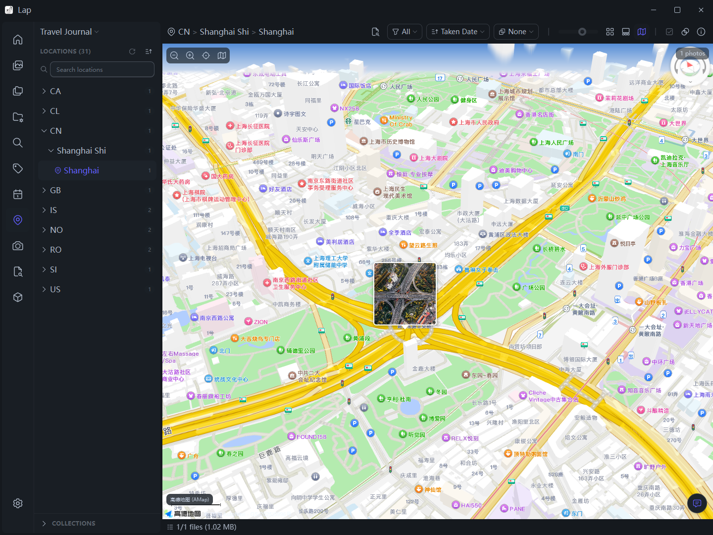
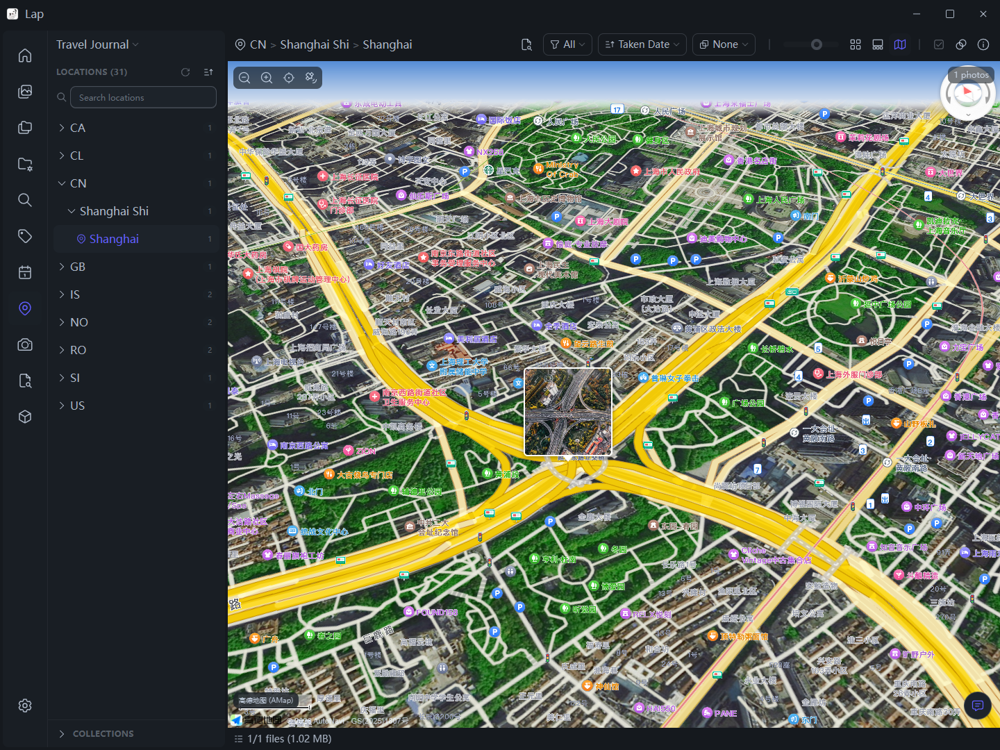

<div align="center">
  
  <h1>Lap - 本地私有照片管理器</h1>
  <h3>适用于 macOS、Windows 和 Linux 的开源桌面照片管理工具。</h3>
  <p>
    <a href="https://github.com/pedoc/lap/releases"></a>
    <a href="https://github.com/pedoc/lap/releases"></a>
    <a href="https://github.com/pedoc/lap/stargazers"></a>
  </p>
</div>

[English](../README.md) | [Deutsch](README.de.md) | [Español](README.es.md) | [Français](README.fr.md) | [Italiano](README.it.md) | [Magyar](README.hu.md) | [Nederlands](README.nl.md) | [Polski](README.pl.md) | [Português](README.pt.md) | [Русский](README.ru.md) | [Українська](README.uk.md) | 中文简体 | [中文繁體](README.zh-TW.md) | [日本語](README.ja.md) | [한국어](README.ko.md)

Lap 是一款开源、本地优先的照片管理工具，帮助您轻松浏览家庭相册、快速查找旧照片，并离线管理大型个人资料库。
它是云端照片服务的隐私替代方案：无强制上传、内置本地 AI 搜索、以文件夹为中心的工作流，且完全免费使用。

本 fork 基于 [julyx10/lap](https://github.com/julyx10/lap)，感谢原作者与贡献者，并在此基础上扩展了检索、媒体理解、模型管理和可恢复的媒体整理流程。

## 下载 Lap

打开 [最新版本发布页面](https://github.com/pedoc/lap/releases/latest)，下载匹配您系统的文件：

| 平台 | 安装包 | 备注 |
| :-- | :-- | :-- |
| **macOS (Apple Silicon / Intel)** | `_aarch64.dmg` / `_x64.dmg` | 签名与公证状态因版本而异 |
| **Windows 10/11 (x64 / ARM64)** | `_x64_en-US.msi` / `_arm64_en-US.msi` | 未签名 — 如果 SmartScreen 阻止下载，请点击**仍要保留** |
| **Windows 免安装版（x64 / ARM64）** | `_x64_portable.zip` / `_arm64_portable.zip` | 完整解压后运行 `Lap.exe`；需要 WebView2 Runtime |
| **Linux (x64 / ARM64)** | `_amd64.deb` / `_arm64.deb` | 适用于 Debian 系发行版（Ubuntu、Debian、Linux Mint 等） |
| **Linux (x64 / ARM64)** | `_amd64.AppImage` / `_aarch64.AppImage` | 赋予文件执行权限后，双击运行 |

Windows 免安装 ZIP 包含原生 DLL、Visual C++ 运行库及配套资源。设置、资料库和缓存仍保存在 Lap 原有的用户数据目录。更新免安装版时，先退出 Lap，再将新版 ZIP 解压到新目录；软件内置 Windows 更新使用 MSI 安装程序。

本 fork 的发布流程允许跳过 Apple 签名和公证。构建成功不代表已经公证，只有发布说明明确确认时才能作此判断。

### 使用 Homebrew 安装 macOS 上游版

此 tap 安装的是上游应用。需要本 fork 所述功能时，请使用上方发布页的安装包。

```bash
brew tap julyx10/lap
brew install --cask lap
```

## 屏幕截图

以下为当前 Windows 版的真实截图，使用英文界面和独立示例图库。点击图片可查看大图。[示例素材出处与截图说明](../docs/public/screenshots/current/README.md)。

**首页：精选照片、图库统计，以及可展开月份的影像时间轴。**

<p align="center">
  <a href="../docs/public/screenshots/current/home.webp"></a>
</p>

**组合筛选：嵌套“全部满足／任一满足”条件，预览结果并保存为智能相册。**

<p align="center">
  <a href="../docs/public/screenshots/current/combined-filters.webp"></a>
</p>

**智能相册：按规则动态整理照片，用虚拟文件夹组织相册。**

<p align="center">
  <a href="../docs/public/screenshots/current/smart-albums.webp"></a>
</p>

**媒体聊天：引用两张照片，通过自行配置的 OpenAI 兼容服务比较封面候选。**

<p align="center">
  <a href="../docs/public/screenshots/current/media-chat.webp"></a>
</p>

**本地对象识别：查看真实 RF-DETR 检测结果，并可手工修订。**

<p align="center">
  <a href="../docs/public/screenshots/current/objects.webp"></a>
</p>

**本地文字识别：搜索照片中的文字，查看命中区域，并可复制或修订结果。**

<p align="center">
  <a href="../docs/public/screenshots/current/ocr.webp"></a>
</p>

**高德三维地图：旋转、俯仰原生地图，按当前筛选条件浏览带地理标记的照片。**

<p align="center">
  <a href="../docs/public/screenshots/current/map-amap-3d.webp"></a>
</p>

**高德卫星地图：切换卫星影像并保留照片标记；地图服务需联网并配置自己的凭据。**

<p align="center">
  <a href="../docs/public/screenshots/current/map-amap-satellite.webp"></a>
</p>

## 为什么选择 Lap

- **本地优先设计**：直接浏览和整理自己的照片文件夹，无需云账号。
- **不锁定资料库**：直接使用现有文件夹，无需将所有内容导入封闭数据库。
- **自主选择 AI**：语义检索、OCR、对象和人脸识别可在本机运行，也可自行配置在线服务扩展能力。
- **为大型资料库优化**：分页浏览、照片分组及视窗优先的缩略图加载，将资源集中于正在查看的照片。
- **开源且免费**：无订阅、无强制生态绑定，代码可自行审查。

## 功能特性

### 浏览与整理

- **首页概览**：精选照片、图库统计、年／月影像时间轴和往年今日。
- **灵活浏览资料库**：按日期、文件夹、地点、相机、镜头、标签、评分和人脸筛选，支持排序和搜索。
- **以文件夹为中心的工作流**：支持多个资料库、拖放导入/导出、复制粘贴导入/导出、文件系统同步，以及安全的移动、复制和删除。
- **智能相册**：嵌套条件、虚拟文件夹、自定义分组排序，以及人工包含／排除。
- **标题、合集与标签**：整理照片而无需移动或复制原件；标题独立于文件名。
- **按日期整理导入**：支持按日、月、年或单一文件夹导入，保留原文件名并跳过重复内容。
- **可追踪扫描**：区分文件核对、预览和搜索准备阶段，查看目录报告及扫描历史，安全暂停后继续，并定向重试已记录的文件错误。
- **日常操作体验**：工具栏按空间逐项展开、侧栏拖动排序、主窗口内设置、图库框选、快捷键和未保存编辑保护。
- **离线相册与多种媒体**：离线磁盘仍可用缓存浏览；支持 60 多种照片／RAW／视频格式、实况／动态照片播放及 RAW + JPEG/HEIC 关联配对。RAW 预览可选内嵌图或本地渲染，并可调节亮度。

### 检索、识别与媒体聊天

- **组合筛选**：用嵌套“全部满足／任一满足”条件组合已有元数据、人物、对象和图片文字，预览结果并可保存为智能相册。
- **本地语义检索**：文本找图、视觉相似度和主题检索；可选多语言模型支持 50 多种语言，具体能力取决于所选模型。
- **本地图片文字识别**：文字搜索、命中框高亮、逐行复制、临时区域提取和人工修订，并可按需启用空闲增量识别。
- **本地对象与人脸识别**：检测框叠层、人工审核／修订，以及对象类别／数量筛选。任务按类型分别排队，手动选图在当前照片处理完后优先执行，已完成结果保留。
- **自然语言找图与找视频**：分别检索分析文本或原画面 Embedding 索引，按模型和相册限定范围；视频命中可跳转对应采样片段，采样不代表逐帧覆盖或精确事件起止。
- **可选媒体聊天**：接入自己的 OpenAI 兼容生成服务，引用照片／视频采样帧、流式回答、通过已启用工具检索，并在采用前预览和编辑标题、说明及标签建议。

本地识别在本机执行。明确授权使用在线生成／Embedding 服务时，相关文字或处理后的媒体会发送至所配置服务，并可能产生费用。检索需先建立对应索引；配置服务不会自动上传或分析全库。详见[媒体理解与检索](../docs/media-understanding.md)、[图片文字识别](../docs/ocr.md)。

### 编辑与恢复

- **重复照片清理**：查看可释放空间，跨重复组批量清理。
- **选片与对比工具**：包含四窗格图片对比查看器。
- **内置编辑**：支持裁剪、任意角度拉直、旋转、翻转、缩放和基础图像调整。
- **照片拼图**：将所选照片排成网格、马赛克或照片堆，合成一张拼图。
- **已隐藏与最近删除**：可选应用锁；普通删除默认进入可恢复区域，关联媒体整组处理。恢复先预检，可选原位置、冲突整组重命名或指定图库目录，不覆盖已有文件。应用锁不加密文件。
- **媒体后台任务**：显示进度，可安全停止并重试未完成项。停止保留已完成组，不撤销已有结果；中断恢复沿用已保存计划。
- **带校验的手动备份**：备份资料库数据库、恢复清单和设置，校验完整性后恢复；不包含原图／视频、回收区媒体、模型／运行库和系统凭据库 API Key，媒体磁盘需另行备份。详见[恢复与备份](../docs/media-library.md)。

### 地图、地点与模型配置

- **多地图服务**：高德和腾讯原生 SDK、OSM/Esri、天地图、MapTiler、Mapbox 及自定义 XYZ/WMTS。照片标记与聚合遵循当前筛选；高德原生三维／卫星视图支持旋转和俯仰。使用供应商自己的 SDK，当前未接入 Cesium。
- **地点解析独立配置**：地图显示可与离线 GeoNames 或支持的在线逆地理编码分开选择；地点树按行政层级浏览，批量任务可继续未成功项及重试失败项，保留原始 WGS84 GPS。底图需联网，在线服务可能需要密钥和配额。详见[地图与地点服务](../docs/development/map-services.md)。
- **模型管理与执行设备**：按需下载、校验和验证、兼容清单导入、按模型保存参数和执行诊断；支持 CPU、Windows DirectML、macOS CoreML，以及 Windows x64 可选 CUDA 执行组件。自动模式尝试可用加速并报告回退，显式指定设备时如实报告失败；模型与驱动兼容性各异。详见[CUDA 配置](../docs/cuda-runtime.md)。

### 天地图 Token 申请与配置

如需使用天地图底图，在 **设置 → 高级 → 地图与地点服务** 中配置自己的开发者 Token（也称 Key 或 `tk`）。

1. 在[天地图官网](https://www.tianditu.gov.cn/)注册并登录账号，按页面提示完成账号认证。
2. 打开[天地图控制台](https://console.tianditu.gov.cn/api/key)，进入应用管理，选择创建新应用。
3. 按所需瓦片／逆地理编码 API 及来源授权要求创建应用，复制自己的 **Token**；权限、白名单和配额以控制台为准。
4. 在 Lap 的 **地图与地点服务** 中，将地图显示提供者设为 **天地图**，填写 **Token**；有来源绑定时填写本应用已获授权的 Referer，然后点击 **保存**。
5. 需要在线解析地点时，在独立的地点解析选项中选择服务。底图需联网，在线解析会发送照片经纬度；高德／腾讯的地图 JS Key 与地点解析 Web 服务 Key 分开配置。

各服务的参数和使用边界见[地图与地点服务](../docs/development/map-services.md)。

## 元数据、合集与文件移动

Lap 以文件夹为中心，但 Lap 中显示的所有信息并非都嵌入在原始文件中。如果您也会在 Finder、资源管理器或其他照片应用中管理同一批文件夹，理解这一区别尤为重要。

### 会随文件保留的信息

- 您的原始照片和视频始终是现有文件夹中的普通文件。
- EXIF 拍摄日期、相机、镜头、GPS 和方向等已嵌入文件的元数据，会在 Lap 索引时从文件中读取。
- 保存内置图片编辑时，生成的图片会写入所选目标位置。
- 当您**在 Lap 中**重命名、移动、复制或删除文件时，Lap 会同步更新本地资料库记录，并将 Apple 实况照片组件、AAE 附属文件和已启用的 RAW + JPEG/HEIC 配对等关联资源一并处理。

### Lap 在本地存储的信息

以下是 Lap 的资料库数据，保存在 Lap 的本地数据库或资料库配置中，不会写入 EXIF、IPTC 或 XMP 附属文件：

- 标题、合集、标签、注释、收藏、评分和选片状态（包括已选与已排除）
- 智能相册及其规则、分组、排序和顺序
- AI 搜索数据、人脸数据、缩略图以及其他索引或缓存数据

当文件在 Lap 外被复制、导出或移动时，这些数据不会随文件一起传递，也不会自动提供给其他应用。

### 在 Lap 外管理文件

Lap 可以重新扫描文件夹并发现许多文件系统变化。但在 Lap 外重命名、移动、替换或复制文件，可能影响仅保存在 Lap 中的整理信息。

若您依赖标题、合集、标签、注释、收藏、评分或选片状态，建议在 Lap 中重命名和移动文件，以获得最可靠的结果。如果也在 Lap 外管理文件，请将 Lap 的数据库和配置与照片一同备份。您可以在 **设置 → 高级 → 资料库数据维护** 中管理数据库位置并创建备份。

删除 Lap 的数据库或配置会移除这些本地整理和索引数据，但不会删除您的原始媒体文件。

## 卸载 Lap

Lap 直接使用您现有的照片文件夹。卸载 Lap 或删除其数据库和缓存文件，**不会**删除您的原始照片。

常规卸载只会移除应用程序。如需彻底删除 Lap，请先退出 Lap，卸载应用程序，然后按照对应平台的命令删除本地数据库、缩略图缓存和配置文件。

### macOS

如果您通过 Homebrew 安装了 Lap：

```bash
brew uninstall --cask lap
```

如果您手动安装了 Lap，请退出 Lap，并将 `Applications` 文件夹中的 `Lap.app` 移到废纸篓。

删除所有 Lap 数据库、缓存和配置文件：

```bash
rm -rf "$HOME/Library/Application Support/com.julyx10.lap" \
       "$HOME/Library/Caches/com.julyx10.lap" \
       "$HOME/Library/WebKit/com.julyx10.lap"
rm -f "$HOME/Library/Preferences/com.julyx10.lap.plist"
```

### Windows

打开 **设置 > 应用 > 已安装的应用**，找到 **Lap** 并选择 **卸载**。

然后打开 PowerShell，删除所有 Lap 数据库、缓存和配置文件：

```powershell
Remove-Item -Recurse -Force -ErrorAction SilentlyContinue "$env:LOCALAPPDATA\com.julyx10.lap"
Remove-Item -Recurse -Force -ErrorAction SilentlyContinue "$env:APPDATA\com.julyx10.lap"
```

### Linux

使用 DEB 安装的用户，请卸载软件包：

```bash
sudo apt remove lap
```

使用 AppImage 的用户，请退出 Lap 并删除下载的 `.AppImage` 文件。

然后删除所有 Lap 数据库、缓存和配置文件：

```bash
rm -rf "$HOME/.local/share/com.julyx10.lap" \
       "$HOME/.cache/com.julyx10.lap" \
       "$HOME/.config/com.julyx10.lap"
```

如果您在 Lap 设置中选择了自定义数据库存储目录，请在确认其中仅包含 Lap 数据库文件后，单独删除该目录。

## 从源码构建

编译要求: Node.js 20+, pnpm, Rust stable.

```bash
# macOS 系统依赖
xcode-select --install
brew install nasm pkg-config autoconf automake libtool cmake

# Linux 系统依赖
# sudo apt install libwebkit2gtk-4.1-dev libappindicator3-dev librsvg2-dev \
#   patchelf libdbus-1-dev nasm clang pkg-config autoconf automake libtool cmake

# 克隆并编译
git clone --recursive https://github.com/pedoc/lap.git
cd lap
git submodule update --init --recursive
cargo install tauri-cli --version "^2.0.0" --locked
cd src-vite && pnpm install && cd ..
cargo tauri dev
```

启动后，在 **设置 → AI 模型** 中下载、选择并配置模型；FFmpeg 在 **设置 → 网络** 中下载。可选 LLM／Embedding 服务在 **AI 模型 → 媒体理解** 配置，按使用的能力授权和检测。详见[媒体服务](../docs/media-understanding.md)、[CUDA 配置](../docs/cuda-runtime.md)及[模型开发说明](../docs/development/ai-models.md)。前端测试需要 Node.js 22+。

发行版软件包可以链接系统 libheif（1.17 或更新版本），而不使用内置的 libheif 和 libde265。构建时设置 `LAP_SYSTEM_LIBHEIF=1`。这样就无需 `third_party/libheif` 和 `third_party/libde265` 这两个子模块。HEVC 解码取决于系统 libheif 的编解码插件。

## 支持格式

Lap 支持 60+ 种照片、RAW 和视频格式。

| 类型 | 格式清单 |
| :--- | :--- |
| 常规图片 | JPG/JPEG/JFIF, PNG, GIF, BMP, TIFF, WebP, HEIC/HEIF/HIF, AVIF, JXL, PSD, EXR, HDR/RGBE, TGA, JPEG 2000 (JP2/J2K/J2C/JPC/JPF/JPX), DDS, DPX, QOI |
| RAW 照片 | CR2, CR3, CRW, NEF, NRW, ARW, SRF, SR2, RAF, RW2, ORF, PEF, DNG, SRW, RWL, MRW, 3FR, MOS, DCR, KDC, ERF, MEF, RAW, MDC |
| 视频 | MP4, MOV, M4V, MKV, AVI, FLV, TS/M2TS, WMV, WebM, 3GP/3G2, F4V, VOB, MPG/MPEG, ASF, DIVX 等。所有平台均支持 H.264 播放；在不支持原生播放时，系统会自动进行兼容性处理。macOS 原生支持 HEVC/H.265 和 VP9。 |

### Linux 视频播放

Lap 使用系统 GStreamer 插件播放视频，AppImage 版本也不例外。如果在 Ubuntu、Debian 或 Linux Mint 上无法播放视频，请安装：

```bash
sudo apt install gstreamer1.0-libav gstreamer1.0-plugins-good
```

## 技术架构

- 核心: Tauri + Rust
- 前端: Vue + Vite + Tailwind CSS
- 数据: SQLite

### 关键库

| 库 | 用途 |
| :-- | :-- |
| [LibRaw](https://github.com/LibRaw/LibRaw) | RAW 图像解码与缩略图提取 |
| [libheif](https://github.com/strukturag/libheif) | HEIC/HEIF/HIF 图像解码与预览生成 |
| [libjpeg-turbo](https://libjpeg-turbo.org/) | 快速 JPEG 解码与缩略图生成 |
| [FFmpeg](https://ffmpeg.org/) | 视频处理与缩略图生成 |
| [Video.js](https://videojs.com/) | 跨平台视频播放界面 |
| [ONNX Runtime](https://onnxruntime.ai/) | 本地 AI 模型推理引擎 |
| [CLIP](https://github.com/openai/CLIP) | 图文相似度搜索 |
| [InsightFace](https://github.com/deepinsight/insightface) | 人脸检测与识别 |
| [Leaflet](https://leafletjs.com/) | 地理照片的栅格地图渲染；高德／腾讯使用各自原生 SDK |
| [daisyUI](https://daisyui.com/) | UI 组件库 |

## 开源许可证

GPL-3.0-or-later。详情请参阅 [LICENSE](../LICENSE)。

## 隐私

有关数据处理和可选在线服务的详情，请参阅[隐私政策](../PRIVACY.md)。
